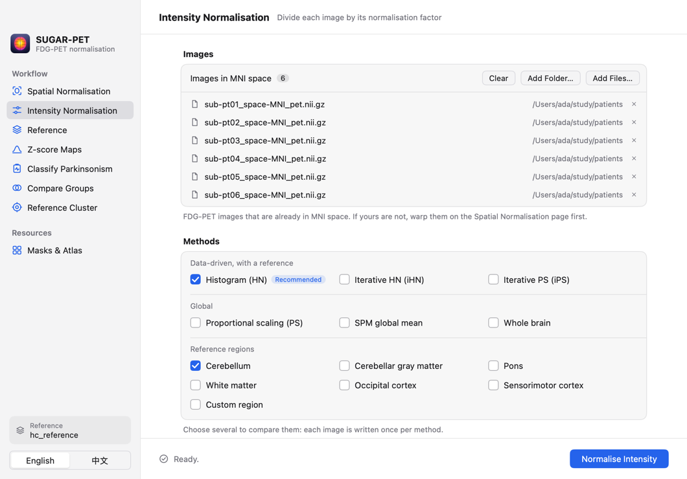
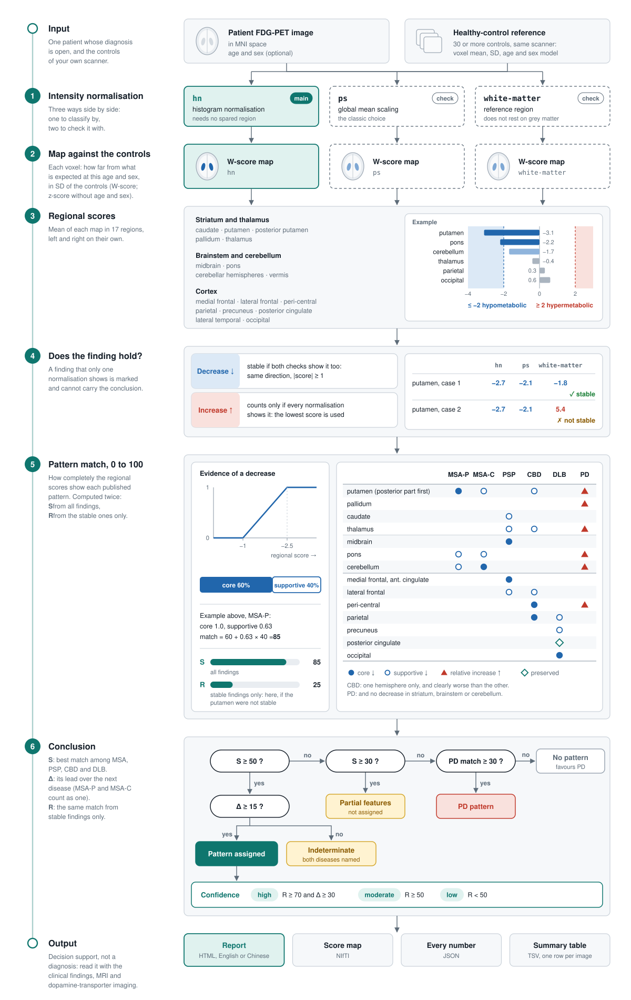

# sugar-pet

**S**tandardized **U**ptake **G**lobal **A**nd **R**egional-normalization for brain FDG-**PET**.

[中文说明](README_zh.md)

FDG-PET voxel values depend on the injected dose, blood glucose, body weight and
more, so two scans cannot be compared directly. *Intensity normalisation* fixes
this by dividing each image by one number, the **normalisation factor**.
sugar-pet estimates that factor with the methods people actually use, including
the histogram-based methods of
[López-González et al., NeuroImage 2020](https://doi.org/10.1016/j.neuroimage.2020.117229):

```
normalised image = image / factor
```

Everything else is just a different way of finding `factor`.

## Install

```bash
pip install git+https://github.com/lijiaxiang63/sugar-pet
```

or, to work on the code:

```bash
git clone https://github.com/lijiaxiang63/sugar-pet && cd sugar-pet && uv sync
```

Python 3.10+; depends only on numpy, scipy and nibabel. Group statistics
(`sugar-pet compare`) additionally need
[GrouVox](https://github.com/lijiaxiang63/GrouVox):

```bash
pip install "sugar-pet[stats] @ git+https://github.com/lijiaxiang63/sugar-pet"
```

## Desktop app

[`app/`](app) holds SUGAR-PET, a desktop app with the same methods and
nothing to install beside it: no Python, and no MATLAB except for the one
optional page that drives SPM. It is one small native
program (about 12 MB) for macOS, Windows and Linux, written in Go with
[MyGo](https://github.com/egoist/mygo)'s native UI, in English and Chinese.



Its pages follow the workflow below: **Spatial Normalisation**,
**Intensity Normalisation**, **Reference**, **Z-score Maps**,
**Classify Parkinsonism**, **Compare Groups**, **Reference Cluster**, and the built-in
**Masks & Atlas**. Files can be dropped onto the lists. The app reads and
writes the same files as the command line (reference folders, `factors.tsv`,
output names, cluster reports, classification reports), so the two can be
mixed.

The two normalisations are different steps. *Spatial* normalisation warps a
native-space PET into MNI space; it is `sugar-pet spatial-norm`, needs
MATLAB and SPM12/SPM25 (the app finds MATLAB and asks for the SPM folder),
and is only for images that are not in MNI space yet. *Intensity*
normalisation, the subject of this package, divides each image by its
factor and needs nothing else.

Build it with Go 1.27+:

```bash
cd app
go tool mygo build        # this machine: build/<os>-<arch>/
go tool mygo build -platform darwin/universal,windows/amd64,linux/amd64
go tool mygo dev          # run it while working on the code
```

The numeric core ([`app/core`](app/core)) is a Go port of this package,
GrouVox's two-sample t-test and corrections included. `app/parity/run.py`
runs the same commands through both and compares every output: images agree
to about 1e-6 of their range, tables and cluster reports exactly.
`go test ./...` in `app` drives the app's pages through a whole analysis of
made-up images. With `SPM_PATH` set to an SPM folder, `run.py` also warps
`<work>/native/*` through both. The macOS app is signed ad hoc, not notarised: open it the
first time with right-click > Open.

## Quick start

Your images must already be **spatially normalised to MNI space** (any voxel
size or bounding box). See [Images not in MNI space yet?](#images-not-in-mni-space-yet)
if they are not.

```bash
# 1. Reference-region method: no other data needed
sugar-pet normalize sub-01_pet.nii.gz -m cerebellum -o out/

# 2. Histogram method (recommended): build a healthy-control reference once ...
sugar-pet build-reference controls/*.nii.gz -o hc_reference/

# ... then use it for every patient
sugar-pet normalize patients/*.nii.gz -m hn -r hc_reference/ -o out/
```

`out/` then contains one normalised image per input
(`sub-01_desc-hn_pet.nii.gz`) and `factors.tsv` with the factor of every image.

## Methods

Run `sugar-pet methods` to see this list in the terminal.

| `-m`             | How the factor is found                                                    | Needs controls |
| ---------------- | -------------------------------------------------------------------------- | :------------: |
| `whole-brain`    | Mean uptake of the whole brain (gray + white matter)                       |       no       |
| `cerebellum`     | Mean uptake of the whole cerebellum (RRC in the paper)                     |       no       |
| `cerebellar-gm`  | Mean uptake of cerebellar gray matter                                      |       no       |
| `pons`           | Mean uptake of the central pons                                            |       no       |
| `white-matter`   | Mean uptake of deep cerebral white matter                                  |       no       |
| `occipital`      | Mean uptake of the occipital cortex                                        |       no       |
| `sensorimotor`   | Mean uptake of primary sensorimotor cortex                                 |       no       |
| `region`         | Mean uptake of any region you choose (`--mask` or `--labels`, see below)   |       no       |
| `ps`             | **Proportional scaling**: mean uptake of the gray-matter mask              |       no       |
| `spm-global`     | SPM's global mean (all voxels above 1/8 of the image mean)                 |       no       |
| `hn`             | **Histogram normalisation**: divide the image by the mean of the controls, take the *most frequent* ratio | yes |
| `ips`            | **Iterative PS**: do PS, find hypometabolic voxels, redo PS without them   |      yes       |
| `ihn`            | **Iterative HN**: do HN, find hypometabolic voxels, redo HN without them   |      yes       |

Several methods at once: `-m cerebellum,ps,hn`, or `-m all`. Add
`--factors-only` to get just the table.

`ps` and `whole-brain` are plain region means like the others; only the region
differs. `ps` uses gray matter (as in the paper), `whole-brain` gray and white
matter together.

Options for the reference regions:

| Option               | Meaning                                                                   |
| -------------------- | ------------------------------------------------------------------------- |
| `--mask NAME_OR_FILE` | Use another region: a [built-in mask](#built-in-masks) or your own NIfTI file in MNI space |
| `--labels 34,85`     | Build the region from atlas labels (`sugar-pet labels` lists them)        |
| `--statistic median` | Median of the region instead of its mean (also for `ps`)                  |
| `--target 50`        | Scale the output so that the reference is 50 instead of 1 (any method)    |

For example, the paper's two other reference regions are built-in masks:
`-m region --mask brainstem` (RRBS) and `-m region --mask temporal-left`
(RRTL; pick the side *opposite* the lesion).

### Which one should I use?

Following the paper's conclusions:

* **`hn` is a good default.** It needs no assumption about which regions are
  affected and was the best data-driven method. `ihn` gives almost the same
  factor (see [notes](#how-it-works-and-where-it-differs-from-the-paper)).
* **`ps` is biased when hypometabolism is large.** The lesion lowers the global
  mean, the factor comes out too small, and healthy tissue then looks
  *hyper*metabolic. `ips` removes most of that bias.
* **A reference region is fine only if it is large and truly spared by the
  disease.** Small regions such as the pons are noisy.

Which regions are spared depends on the disease. Some examples:

| Disease                          | Avoid as reference                    | Usually spared            |
| -------------------------------- | ------------------------------------- | ------------------------- |
| Alzheimer's disease              | —                                     | cerebellum, pons, sensorimotor |
| Multiple system atrophy          | cerebellum, pons                      | occipital                 |
| Progressive supranuclear palsy   | pons (midbrain atrophy nearby)        | occipital, cerebellum     |
| Corticobasal syndrome            | sensorimotor                          | occipital, cerebellum     |
| Dementia with Lewy bodies, PCA   | occipital                             | cerebellum, sensorimotor  |

These are rules of thumb; check the literature for your disease and stage.

`hn`, `ips` and `ps` assume that *most* of the gray matter is normal. If a
disease lowers uptake almost everywhere they cannot see it; a white-matter
reference or a [reference cluster](#reference-cluster) is a useful
sensitivity check in that case.

## Recommended workflow

For a study that compares patients with healthy controls. It was written with
atypical parkinsonism in mind (MSA, PSP, CBS), where the classic reference
regions, cerebellum and pons, are often affected themselves.

**1. Treat patients and controls the same way.** Same scanner and
reconstruction if at all possible, the same spatial normalisation, and a look
at every warped image.

**2. Build one reference from all your controls,** with their age and sex:

```bash
sugar-pet build-reference controls/*.nii.gz -o hc_reference/ --covariates participants.tsv --stats-for occipital,white-matter
```

**3. Compare the groups with `hn`.** This is the main analysis.

```bash
sugar-pet compare --group1 patients/*.nii.gz --group2 controls/*.nii.gz -m hn -r hc_reference/ -o stats/ --covariates participants.tsv
```

This normalises both groups, smooths them and tests every voxel with age and
sex in the model (see [Comparing two groups](#comparing-two-groups)). If you
prefer other statistics software, write the normalised images with
`sugar-pet normalize` and switch off any global scaling there (in SPM: no
proportional scaling, no ANCOVA), because the images are already normalised.

**4. For single patients, make W-score maps,** which are adjusted for age and
sex:

```bash
sugar-pet zmap patients/*.nii.gz -m hn -r hc_reference/ -o wmaps/ --covariates participants.tsv
```

For a patient whose diagnosis is open, `sugar-pet classify` reads such a map
against the patterns of MSA, PSP, CBD, DLB and PD and writes a report: see
[Classifying parkinsonism](#classifying-parkinsonism).

**5. Repeat steps 3 and 4 with two other references** (`-m occipital`, then
`-m white-matter`) as a sensitivity analysis:

* `occipital` is an anatomical region that MSA, PSP and CBS usually spare.
* `white-matter` does not assume that most gray matter is normal, so it can
  show a diffuse decrease that `hn` cannot. It is noisier.

If the findings hold, report the `hn` results and mention the check. If they
change, say so: a finding that depends on the normalisation is not robust.

**In the paper, state** the method (`hn`), the number, age range and sex of
the controls, the smoothing (8 mm by default), and the sugar-pet version.

**Avoid:**

* a reference region the disease affects (cerebellum and pons in MSA, pons in
  PSP, sensorimotor cortex in CBS);
* normalising patients and controls with different methods;
* plain z-scores when patients and controls differ in age;
* a [reference cluster](#reference-cluster) derived from the very patients you
  then test.

## The healthy-control reference

`hn`, `ips` and `ihn` compare each image with a group of healthy controls.
`sugar-pet build-reference` summarises the controls into a small folder:

| File               | Content                                                    |
| ------------------ | ---------------------------------------------------------- |
| `template.nii.gz`  | Mean of the controls after proportional scaling (the HN "normality template") |
| `ps_std.nii.gz`    | Standard deviation of the controls after PS                |
| `hn_mean.nii.gz`, `hn_std.nii.gz` | Mean and SD of the controls after HN        |
| `mask.nii.gz`      | Voxels used for the estimate (gray-matter mask)            |
| `reference.json`   | Number of controls, smoothing, factors of each control     |
| `stats-<method>_mean.nii.gz`, `..._std.nii.gz` | Only with `--stats-for`: mean and SD of the controls after another method (for [z-score maps](#z-score-maps)) |
| `model-<method>_beta.nii.gz`, `..._sd.nii.gz` | Only with `--covariates`: how the controls depend on age and sex (for [W-scores](#adjusting-for-age-and-sex-w-scores)) |

Use controls from the same scanner and reconstruction as your patients, and
processed the same way. Twenty or more is a sensible minimum.

By default the controls, and later each patient, are smoothed with an 8 mm
Gaussian kernel **only for estimating the factor**; the image that is written
is your input divided by the factor, never smoothed. If your images are already
smoothed, pass `--fwhm 0` to both commands.

## Options for the iterative methods

| Option            | Default | Meaning                                                      |
| ----------------- | ------- | ------------------------------------------------------------ |
| `--p-threshold`   | `0.01`  | Voxels different from controls at this (uncorrected) p are excluded |
| `--exclude`       | `hypo`  | `hypo`: exclude only hypometabolic voxels (paper). `both`: also hypermetabolic ones |
| `--max-iter`      | `1`     | Number of re-estimations (paper: 1)                          |
| `--save-masks`    | off     | Also write the mask each factor was estimated from           |

## Z-score maps

A z-score map shows how far each voxel of a normalised image is from the
controls: `z = (image − control mean) / control SD`. Negative means lower
uptake than the controls.

```bash
sugar-pet zmap patients/*.nii.gz -m hn -r hc_reference/ -o zmaps/
```

writes `sub-01_desc-hn_zmap.nii.gz`. The image is smoothed like the controls
were before it is compared. `ps`, `ips`, `hn` and `ihn` work with any
reference. For a reference region, the controls must have been scaled with the
same region, so name it when building the reference:

```bash
sugar-pet build-reference controls/*.nii.gz -o hc_reference/ --stats-for cerebellum,pons
sugar-pet zmap patients/*.nii.gz -m pons -r hc_reference/ -o zmaps/
```

(`--stats-for all` stores every reference region.)

### Adjusting for age and sex (W-scores)

Uptake changes with age and differs a little between the sexes. If your
patients are older than your controls, a plain z-score mixes that up with the
disease. A W-score compares each patient with what the controls predict *for a
person of the same age and sex*:
`w = (image − predicted) / residual SD of the controls`.

Give `build-reference` a table with the age and sex of the controls, and
`zmap` a table with those of the patients:

```bash
sugar-pet build-reference controls/*.nii.gz -o hc_reference/ --covariates controls.tsv
sugar-pet zmap patients/*.nii.gz -m hn -r hc_reference/ -o wmaps/ --covariates patients.tsv
```

writes `sub-01_desc-hn_wmap.nii.gz`. Without `--covariates`, `zmap` still
writes plain z-scores from the same reference.

The table is a TSV or CSV file such as a BIDS `participants.tsv`:

```
participant_id	age	sex
sub-01	63	F
sub-02	58	M
```

Rows are matched to images by `participant_id` (`sub-01` matches
`sub-01_..._pet.nii.gz`), or by a column called `image` holding file names.
Only the columns you adjust for are read. `--adjust-for age,sex` is the
default; any column works if it is numeric or has exactly two values. Age
enters as a straight line, and you get a warning when a patient is older or
younger than every control.

## Classifying parkinsonism

Given the scan of one patient whose diagnosis is open, `sugar-pet classify`
finds where uptake is lower or higher than in the controls, says which of the
parkinsonian syndromes that pattern looks like, and writes a report:

```bash
sugar-pet build-reference controls/*.nii.gz -o hc_reference/ --covariates controls.tsv --stats-for white-matter
sugar-pet classify sub-01_pet.nii.gz -r hc_reference/ -o reports/ --covariates patients.tsv --lang zh
```

| File in `reports/`               | Content                                                     |
| -------------------------------- | ----------------------------------------------------------- |
| `sub-01_report.html`             | The report, in English or Chinese (`--lang`). One page that needs no other file; print it to PDF from a browser |
| `sub-01_desc-hn_wmap.nii.gz`     | The map the report rests on (`_zmap` without `--covariates`) |
| `sub-01_classification.json`     | Every number of the report: regions, patterns, conclusion   |
| `classification.tsv`             | One row per image: conclusion and the match with each pattern |

The files are named after the image (`sub-01_pet.nii.gz` gives `sub-01`). Two
images that would get the same name, such as `a/pet.nii.gz` and `b/pet.nii.gz`,
are refused before anything is written, so that one patient's report cannot
replace another's.

**It is decision support, not a diagnosis.** The diagnostic criteria (MSA 2022,
PSP 2017, DLB 2017) count FDG-PET as supportive only, and the rules below come
from the literature: they were not fitted to or validated on your patients.
Read the result with the clinical findings, MRI and dopamine-transporter
imaging.

The whole procedure at a glance:



The steps in words:

1. **A map against the controls.** The image becomes a [W-score map](#adjusting-for-age-and-sex-w-scores)
   (a z-score map without `--covariates`), with `hn` by default: for a patient
   without a diagnosis you cannot say which region the disease spares, and
   `hn` does not need one.
2. **Regional scores.** The map is averaged over 17 regions, left and right on
   their own: caudate, putamen and its posterior part, pallidum, thalamus,
   midbrain, pons, cerebellar hemispheres and vermis, medial and lateral
   frontal, peri-central, parietal, precuneus, posterior cingulate, lateral
   temporal and occipital cortex. From −2 a region counts as hypometabolic,
   from 2 as hypermetabolic. A region is scored only if at least half of it
   lies inside the image.
3. **The same under other normalisations.** By default proportional scaling
   (`ps`), and a white-matter reference if the reference was built with
   `--stats-for white-matter` (recommended: it does not rest on gray matter).
   A finding the others do not show is marked. An *increase* counts only if
   every normalisation shows it, because global scaling makes spared regions
   look hypermetabolic ([Borghammer et al., 2009](https://www.sciencedirect.com/science/article/abs/pii/S1053811908008896)).
4. **Pattern match**, from 0 to 100 for each pattern: 60% for its core
   features, 40% for the supportive ones.

| Pattern | Core features | Supportive features |
| ------- | ------------- | ------------------- |
| MSA-P   | putamen ↓ (posterior part first) | pons ↓, cerebellum ↓ |
| MSA-C   | cerebellum ↓ | pons ↓, putamen ↓ |
| PSP     | midbrain ↓, medial frontal cortex and anterior cingulate ↓ | caudate ↓, thalamus ↓, lateral frontal cortex ↓ |
| CBD/CBS | peri-central and parietal cortex ↓ on one side, clearly more than on the other | thalamus ↓, putamen ↓, lateral frontal cortex ↓ on that side |
| DLB     | occipital cortex ↓ | parietal cortex ↓, precuneus ↓, posterior cingulate preserved (island sign) |
| PD      | putamen, pallidum, thalamus, pons, cerebellum, sensorimotor cortex ↑ | no decrease in striatum, brainstem or cerebellum |

The conclusion is one of:

* **a pattern**, when one scores at least 50 and leads the next disease by 15
  (confidence *high* from 70 with a lead of 30, else *moderate*; MSA-P and
  MSA-C count as one disease). The confidence goes by the findings that hold
  under every normalisation: if those alone score below 50, it is *low*, and
  the report says so;
* **indeterminate**, when two diseases score alike: both are named;
* **partial features** of a pattern (30 to 50), which is not enough to assign it;
* **PD pattern**, when no pattern of atypical parkinsonism is there but the
  relative increase is;
* **no pattern**: in a patient with parkinsonism this favours PD, whose scan
  is often close to normal early on.

| Option         | Default | Meaning                                                        |
| -------------- | ------- | -------------------------------------------------------------- |
| `-m`           | `hn`    | Normalisation the classification rests on                      |
| `--check`      | `ps`, and `white-matter` if the reference has it | Other normalisations to check with, or `none` |
| `--covariates` | none    | Table with the age and sex of the patients: W-scores           |
| `--lang`       | `en`    | Language of the report: `en` or `zh`                           |

Use controls from the same scanner and reconstruction, scanned like the
patients (eyes open or closed alike); 30 or more are recommended for the map
of a single patient, and the report says so when there are fewer.

**Why rules and not a trained classifier?** The validated alternatives need
things that cannot be shipped. Disease-related covariance patterns (PDRP,
MSARP, PSPRP; [Tang et al., 2010](https://doi.org/10.1016/S1474-4422(10)70002-8))
are not distributed and must be derived again and validated on each scanner;
deep-learning models keep their weights private and depend on scanner and
reconstruction. What every site can do is compare one patient with its own
controls and read the map against the published patterns, which is how
[single-subject SPM maps](https://doi.org/10.1111/ene.13269) are read by eye.
This command does that reading in a fixed, reproducible way and shows every
number it used.

## Reference cluster

Instead of choosing a reference region from an atlas, you can let a patient
group show which voxels its disease spares
([Yakushev et al., 2009](https://doi.org/10.1016/j.neuroimage.2008.07.015)).
After proportional scaling, spared regions look *hyper*metabolic compared with
controls, because the lesions pulled the global mean down. Those voxels become
the reference region:

```bash
sugar-pet reference-cluster patients/*.nii.gz -r hc_reference/ -o cluster.nii.gz
sugar-pet normalize patients/*.nii.gz -m region --mask cluster.nii.gz -o out/
```

`--p-threshold` (default 0.001, uncorrected) and `--min-cluster` (default
1 mL) control which voxels are kept.

The cluster depends on the group it came from. Comparing that same group with
controls afterwards is circular: derive the cluster from other patients, or
cross-validate.

## Comparing two groups

```bash
sugar-pet compare --group1 patients/*.nii.gz --group2 controls/*.nii.gz -m hn -r hc_reference/ -o stats/ --covariates participants.tsv
```

In one go this

1. normalises every image of both groups with the same method,
2. smooths them (8 mm by default),
3. runs a two-sample t-test at every voxel, with age and sex in the model,
4. corrects for multiple comparisons and lists the surviving clusters with
   their anatomical labels.

The statistics are done by [GrouVox](https://github.com/lijiaxiang63/GrouVox)
(see [Install](#install)). The result is group 1 minus group 2: with patients
as group 1, **negative T means hypometabolism**.

| File in `stats/`                         | Content                                              |
| ---------------------------------------- | ---------------------------------------------------- |
| `group1_vs_group2_T.nii.gz`              | T-map, unthresholded                                 |
| `ClusterThresholded_group1_vs_group2_T.nii.gz` | T-map with only the clusters that survive      |
| `ClusterReport_group1_vs_group2_T.csv`   | One row per cluster: size, peak, AAL and Harvard-Oxford regions |
| `group1_vs_group2_factors.tsv`           | Normalisation factor of every image                  |
| `group1_vs_group2_mask.nii.gz`           | Voxels that were tested                              |
| `group1_vs_group2_beta.nii.gz`, `..._cohen_f2.nii.gz` | Model coefficients and effect size      |

| Option             | Default          | Meaning                                                    |
| ------------------ | ---------------- | ---------------------------------------------------------- |
| `--covariates`     | none             | One or more tables listing all images, e.g. one for patients and one for controls ([format](#adjusting-for-age-and-sex-w-scores)) |
| `--adjust-for`     | `age,sex`        | Columns of those tables to put in the model                |
| `--correction`     | `grf`            | `grf`: cluster-level correction (`--voxel-p 0.001`, `--cluster-p 0.05`); `fdr`: voxel-level (`--q 0.05`); `none`. Two-tailed |
| `--analysis-mask`  | `gray-matter`    | Voxels to test: a built-in mask or your own file           |
| `--fwhm`           | as the reference | Smoothing in mm; 0 if the images are already smoothed      |
| `--name`           | `group1_vs_group2` | Prefix of the result files                               |
| `--keep-images`    | off              | Keep the normalised, smoothed images that were tested      |

Each person should appear once: the test assumes independent subjects.

## Python

```python
from sugar_pet import Reference, normalize, zmap

ref = Reference.build(control_files, fwhm=8)  # or Reference.load("hc_reference")
ref.save("hc_reference")

res = normalize("sub-01_pet.nii.gz", method="ihn", reference=ref)
print(res.factor)  # the normalisation factor
print(res.info)  # voxels used, fraction excluded, ...
res.save("sub-01_desc-ihn_pet.nii.gz")
res.mask_image()  # the voxels the factor was estimated from

z = zmap("sub-01_pet.nii.gz", method="ihn", reference=ref)  # a NIfTI image

# W-scores: build the reference with the controls' covariates, then pass the patient's
ref = Reference.build(control_files, covariates={"age": ages, "sex": sexes})
w = zmap("sub-01_pet.nii.gz", method="ihn", reference=ref, covariates={"age": 63, "sex": "F"})
```

[Classifying](#classifying-parkinsonism) one patient:

```python
from sugar_pet import classify

res = classify("sub-01_pet.nii.gz", reference=ref, covariates={"age": 63, "sex": "F"})
res.conclusion  # {'category': 'pattern', 'pattern': 'msa-p', 'confidence': 'high', ...}
res.result["regions"]  # the score of every region, each side, under each normalisation
res.result["patterns"]  # the match with each pattern and the features behind it
res.zmap  # the map, a NIfTI image
res.save("reports", "sub-01", lang="zh")  # map, report and numbers
```

A reference region can be a built-in mask, your own file, or any set of labels
of the bundled atlas:

```python
from sugar_pet import atlas_labels, labels_mask, reference_cluster

res = normalize(img, "region", mask="brainstem", statistic="median", target=100)

atlas_labels()  # {21: 'Putamen (R)', 72: 'Putamen (L)', ...}
res = normalize(img, "region", mask=labels_mask([40, 91]))  # both thalami

cluster = reference_cluster(patient_files, ref)
res = normalize(img, "region", mask=cluster)
```

Group comparison (needs GrouVox):

```python
from sugar_pet import compare_groups

ages, sexes = patient_ages + control_ages, patient_sexes + control_sexes  # group 1 first
res = compare_groups(patient_files, control_files, "stats", "hn", reference=ref, covariates={"age": ages, "sex": sexes})
print(res.n_clusters, res.files["cluster_report"])
```

## Built-in masks

`gray-matter`, `parenchyma`, `cerebellum`, `cerebellar-gm`, `pons`,
`white-matter`, `occipital`, `sensorimotor`, `brainstem`, `temporal-left` and
`temporal-right`. `sugar-pet masks -o masks/` writes them as NIfTI files so
you can look at them, and `sugar-pet labels` lists the atlas labels for
`--labels`.

They come from two freely redistributable MNI resources, resampled to 2 mm:
the ICBM 2009c tissue probability maps and the
[CerebrA atlas](https://doi.org/10.1038/s41597-020-0557-9). Masks are resampled
to the grid of each image automatically.

The pons mask is the part of the CerebrA brainstem between z = −44 and −26 mm,
eroded in-plane; treat it as a pragmatic central-pons region, not an anatomical
gold standard. `occipital` is the whole occipital cortex; for the lateral
occipital cortex alone use `--labels 34,85`. For other MNI variants or atlases,
pass your own mask.

## Images not in MNI space yet?

Any spatial normalisation works (SPM, ANTs, ...). If you have PET only and SPM
installed, there is a small wrapper around SPM's "Old Normalise" with a PET
template (needs MATLAB):

```bash
sugar-pet spatial-norm raw/*_pet.nii.gz -o mni/ --spm-path /path/to/spm12 --jobs 4
```

It crops each scan around the head, moves the origin to the brain centre and
writes 2 mm MNI-space images. Always check the result visually. The desktop
app does the same on its **Spatial Normalisation** page.

## How it works, and where it differs from the paper

* **HN.** The ratio image (subject / template) is computed inside the
  gray-matter mask and the peak of its histogram is the factor. A raw histogram
  maximum depends on the bin width, so the histogram is smoothed with a
  Gaussian kernel (a kernel density estimate) before the peak is located.
* **Finding abnormal voxels.** The paper runs SPM's two-sample t-test (one
  patient against the controls). sugar-pet computes the equivalent equal-variance
  t statistic directly, `t = (x − mean) / (sd · √(1 + 1/n))` with n − 1 degrees
  of freedom, so no SPM is needed.
* **iPS.** After voxels are removed, the remaining ones no longer average 1 in
  the controls either. sugar-pet therefore divides the subject's mean by the
  control template's mean over the *same* voxels. `--literal-ips` gives the
  plain mean as written in the paper.
* **iHN ≈ HN.** Hypometabolic voxels sit in the tail of the ratio histogram,
  far from its peak, so removing them barely moves the peak. Expect `hn` and
  `ihn` factors to agree within a fraction of a percent; that robustness is
  exactly why HN works well.
* **One scale.** `ps`, `ips`, `hn` and `ihn` are all scaled so that the
  gray-matter mask of a healthy brain averages about 1.
* **Reference cluster.** The two-sample t-test (patients > controls, equal
  variances) is computed directly from the patient images and the mean and SD
  stored in the reference, so the control images are not needed again.
* **W-scores.** An ordinary least-squares regression of the normalised
  controls on the covariates is fitted at every voxel. As in
  [La Joie et al., 2012](https://doi.org/10.1523/JNEUROSCI.2170-12.2012), the
  residual is divided by the residual SD of the controls, without the extra
  term for the uncertainty of the prediction.
* **Left out on purpose.** Standardising images to zero mean and unit variance
  (common before deep learning) is a shift as well as a scaling, so uptake
  ratios are lost. The log transform and double centring of SSM/PCA covariance
  analysis belong to that analysis, which gives the same result whatever
  scaling was applied before.

In a simulated image with a large 40 % cortical lesion (see `tests/`), the
factor is off by −3.7 % with `ps`, −0.5 % with `ips` and less than 0.1 % with
`hn` and `ihn`, the same ranking the paper reports.

## Development

```bash
uv sync
uv run pytest
uv run ruff check .
```

`scripts/build_atlas.py` regenerates the bundled atlas files from the original
MNI downloads. `scripts/classify_flowchart.py` redraws the flowchart of the
classification (`docs/classify-flow-en.svg` and `-zh.svg`); the thresholds are
written out in it, so change them there when they change in `classify.py`.

The wording and the style sheet of the classification report
(`classify_text.json`, `report.css`) live in `src/sugar_pet/data` and, as a
copy for the desktop app, in `app/core/data`; a test fails when the two differ.

## References

* López-González FJ, Silva-Rodríguez J, Paredes-Pacheco J, et al. Intensity
  normalization methods in brain FDG-PET quantification. *NeuroImage* 2020;222:117229.
* Yakushev I, Hammers A, Fellgiebel A, et al. SPM-based count normalization
  provides excellent discrimination of mild Alzheimer's disease and amnestic
  mild cognitive impairment from healthy aging. *NeuroImage* 2009;44:43–50.
* La Joie R, Perrotin A, Barré L, et al. Region-specific hierarchy between
  atrophy, hypometabolism, and β-amyloid (Aβ) load in Alzheimer's disease
  dementia. *J Neurosci* 2012;32:16265–16273.
* Manera AL, Dadar M, Fonov V, Collins DL. CerebrA, registration and manual
  label correction of Mindboggle-101 atlas for MNI-ICBM152 template.
  *Sci Data* 2020;7:237.
* Fonov V, Evans AC, Botteron K, et al. Unbiased average age-appropriate
  atlases for pediatric studies. *NeuroImage* 2011;54:313–327.
* Meyer PT, Frings L, Rücker G, Hellwig S. 18F-FDG PET in parkinsonism:
  differential diagnosis and evaluation of cognitive impairment.
  *J Nucl Med* 2017;58:1888–1898.
* Caminiti SP, Alongi P, Majno L, et al. Evaluation of an optimized
  [18F]fluoro-deoxy-glucose positron emission tomography voxel-wise method to
  early support differential diagnosis in atypical Parkinsonian disorders.
  *Eur J Neurol* 2017;24:687–e26.
* Tang CC, Poston KL, Eckert T, et al. Differential diagnosis of parkinsonism:
  a metabolic imaging study using pattern analysis. *Lancet Neurol* 2010;9:149–158.
* Niethammer M, Tang CC, Feigin A, et al. A disease-specific metabolic brain
  network associated with corticobasal degeneration. *Brain* 2014;137:3036–3046.
* Borghammer P, Cumming P, Aanerud J, Gjedde A. Artefactual subcortical
  hyperperfusion in PET studies normalized to global mean: lessons from
  Parkinson's disease. *NeuroImage* 2009;45:249–257.
* Wenning GK, Stankovic I, Vignatelli L, et al. The Movement Disorder Society
  criteria for the diagnosis of multiple system atrophy. *Mov Disord* 2022;37:1131–1148.
* Höglinger GU, Respondek G, Stamelou M, et al. Clinical diagnosis of
  progressive supranuclear palsy: the Movement Disorder Society criteria.
  *Mov Disord* 2017;32:853–864.
* McKeith IG, Boeve BF, Dickson DW, et al. Diagnosis and management of dementia
  with Lewy bodies: fourth consensus report of the DLB Consortium.
  *Neurology* 2017;89:88–100.

## License

MIT for the code. The bundled atlas files are covered by the MNI license in
[`src/sugar_pet/data/LICENSE-MNI`](src/sugar_pet/data/LICENSE-MNI).
For research use only; not a medical device.
