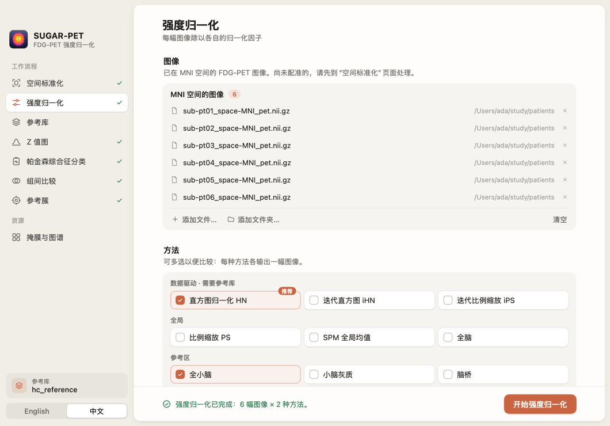

# sugar-pet

**S**tandardized **U**ptake **G**lobal **A**nd **R**egional-normalization：脑 FDG-**PET** 强度归一化工具。

[English](README.md)

FDG-PET 的体素值受注射剂量、血糖、体重等因素影响，不同受试者的图像不能直接比较。
**强度归一化**的做法是把整幅图像除以一个数，即**归一化因子**：

```
归一化后的图像 = 原图像 / 因子
```

各种方法的区别只在于这个因子怎么估计。sugar-pet 提供常用的几种方法，并实现了
[López-González 等, NeuroImage 2020](https://doi.org/10.1016/j.neuroimage.2020.117229)
中基于直方图的方法（HN、iPS、iHN）。

## 安装

```bash
pip install git+https://github.com/lijiaxiang63/sugar-pet
```

开发用：

```bash
git clone https://github.com/lijiaxiang63/sugar-pet && cd sugar-pet && uv sync
```

需要 Python 3.10+，只依赖 numpy、scipy、nibabel。组间统计（`sugar-pet compare`）
还需要 [GrouVox](https://github.com/lijiaxiang63/GrouVox)：

```bash
pip install "sugar-pet[stats] @ git+https://github.com/lijiaxiang63/sugar-pet"
```

## 桌面应用

[`app/`](app) 是 SUGAR-PET 桌面应用：方法与命令行相同，但不需要安装任何环境
（不需要 Python；只有可选的“空间标准化”页面要调用 SPM，才需要 MATLAB）。它是一个约 12 MB 的原生程序，支持 macOS、
Windows 和 Linux，用 Go 和 [MyGo](https://github.com/egoist/mygo) 的原生界面
编写，界面有中文和英文。



页面按下文的推荐流程排列：**空间标准化**、**强度归一化**、**参考库**、**Z 值图**、
**帕金森综合征分类**、**组间比较**、**参考簇**，以及内置的**掩膜与图谱**。文件可以直接拖到列表里。
应用读写的文件与命令行完全一致（参考库文件夹、`factors.tsv`、输出文件名、
团块报告、分类报告），两者可以混用。

两个“normalisation”是不同的步骤。**空间标准化**把原始空间的 PET 配准到 MNI 空间，
即 `sugar-pet spatial-norm`，需要 MATLAB 和 SPM12/SPM25（应用会自动查找 MATLAB，
SPM 文件夹需自行选择），只有图像还不在 MNI 空间时才用得到。**强度归一化**是本工具
的主题：每幅图像除以各自的因子，不需要其他软件。

macOS、Windows 和 Linux 的安装包在
[发布页](https://github.com/lijiaxiang63/sugar-pet/releases)；推送标签 `v<版本号>`
会自动构建并发布（[`release.yml`](.github/workflows/release.yml)）。也可以用
Go 1.27+ 自行构建：

```bash
cd app
go tool mygo build        # 本机平台，输出到 build/<系统>-<架构>/
go tool mygo build -platform darwin/universal,windows/amd64,linux/amd64
go tool mygo dev          # 开发时直接运行
```

数值核心（[`app/core`](app/core)）是本包的 Go 移植，包含 GrouVox 的双样本
t 检验和多重比较校正。`app/parity/run.py` 用两种实现运行同样的命令并逐个比较
输出：图像的差异约为取值范围的 1e-6，表格和团块报告完全一致。在 `app` 中运行
`go test ./...` 会用合成图像把应用各页面的完整分析流程走一遍。macOS 版仅有临时
签名、未公证：首次打开请右键选择“打开”。

## 快速上手

输入图像必须已经**空间标准化到 MNI 空间**（体素大小和包围盒不限）。
还没有标准化的见[图像还不在 MNI 空间？](#图像还不在-mni-空间)。

```bash
# 1. 参考区法：不需要其他数据
sugar-pet normalize sub-01_pet.nii.gz -m cerebellum -o out/

# 2. 直方图法（推荐）：先用健康对照建一次参考库 ...
sugar-pet build-reference controls/*.nii.gz -o hc_reference/

# ... 之后每个患者都用它
sugar-pet normalize patients/*.nii.gz -m hn -r hc_reference/ -o out/
```

`out/` 中每个输入对应一幅归一化图像（`sub-01_desc-hn_pet.nii.gz`），
另有 `factors.tsv` 记录每幅图像的因子。

## 方法

终端里运行 `sugar-pet methods` 可查看同样的列表。

| `-m`             | 因子的估计方式                                             | 需要对照 |
| ---------------- | ---------------------------------------------------------- | :------: |
| `whole-brain`    | 全脑平均摄取（灰质 + 白质）                                |    否    |
| `cerebellum`     | 全小脑平均摄取（文中的 RRC）                               |    否    |
| `cerebellar-gm`  | 小脑灰质平均摄取                                           |    否    |
| `pons`           | 脑桥中央平均摄取                                           |    否    |
| `white-matter`   | 大脑深部白质平均摄取                                       |    否    |
| `occipital`      | 枕叶皮层平均摄取                                           |    否    |
| `sensorimotor`   | 初级感觉运动皮层平均摄取                                   |    否    |
| `region`         | 任意自选区域的平均摄取（`--mask` 或 `--labels`，见下）     |    否    |
| `ps`             | **比例缩放**：灰质掩膜内的平均摄取                         |    否    |
| `spm-global`     | SPM 的全局均值（高于全图均值 1/8 的所有体素）              |    否    |
| `hn`             | **直方图归一化**：图像除以对照均值图，取比值中**出现最多**的值 | 是   |
| `ips`            | **迭代 PS**：先做 PS，找出低代谢体素，去掉后重做 PS        |    是    |
| `ihn`            | **迭代 HN**：先做 HN，找出低代谢体素，去掉后重做 HN        |    是    |

一次用多种方法：`-m cerebellum,ps,hn` 或 `-m all`。加 `--factors-only` 只输出因子表。

`ps` 和 `whole-brain` 与其他参考区法一样，都是直接取区域均值，只是区域不同：
`ps` 用灰质（与文章一致），`whole-brain` 用灰质加白质。

参考区相关的选项：

| 选项                 | 含义                                                             |
| -------------------- | ---------------------------------------------------------------- |
| `--mask 名称或文件`  | 换用其他区域：[内置掩膜](#内置掩膜)的名称，或自己的 MNI 空间 NIfTI 文件 |
| `--labels 34,85`     | 用图谱标签组合出区域（`sugar-pet labels` 列出全部标签）          |
| `--statistic median` | 取区域的中位数而不是均值（`ps` 也适用）                          |
| `--target 50`        | 把输出缩放到“参考值 = 50”而不是 1（任何方法都可用）              |

例如，文章里另外两个参考区是内置掩膜：`-m region --mask brainstem`（RRBS）和
`-m region --mask temporal-left`（RRTL，选病灶**对侧**）。

### 该选哪种？

按照文章的结论：

* **默认推荐 `hn`。** 不需要预先知道哪些脑区受累，是表现最好的数据驱动方法。
  `ihn` 得到的因子几乎相同（原因见[实现说明](#实现说明及与原文的差异)）。
* **低代谢范围大时 `ps` 有偏。** 病灶拉低了全脑均值，因子偏小，
  正常组织反而显得**高**代谢。`ips` 能消除大部分偏差。
* **参考区法只在参考区足够大、且确实不受疾病影响时才可靠。** 脑桥这类小区域噪声大。

哪些区域不受累取决于疾病，举几个例子：

| 疾病                     | 不宜作参考区             | 通常保留               |
| ------------------------ | ------------------------ | ---------------------- |
| 阿尔茨海默病             | —                        | 小脑、脑桥、感觉运动皮层 |
| 多系统萎缩（MSA）        | 小脑、脑桥               | 枕叶                   |
| 进行性核上性麻痹（PSP）  | 脑桥（邻近中脑萎缩）     | 枕叶、小脑             |
| 皮质基底节综合征（CBS）  | 感觉运动皮层             | 枕叶、小脑             |
| 路易体痴呆、后部皮质萎缩 | 枕叶                     | 小脑、感觉运动皮层     |

以上只是经验规律，具体请结合所研究疾病及分期的文献判断。

`hn`、`ips`、`ps` 都假设**大部分**灰质是正常的。如果疾病让几乎所有区域的摄取都下降，
它们看不出来；这时用白质参考区或[参考簇](#参考簇)做敏感性分析会有帮助。

## 推荐流程

适用于“患者与健康对照比较”的研究。写的时候主要考虑非典型帕金森综合征（MSA、PSP、CBS），
这类疾病里常用的参考区（小脑、脑桥）往往本身就受累。

**1. 患者和对照用同样的方式处理。** 尽量来自同一台扫描仪、同样的重建参数，
用同一套空间标准化，并且每幅标准化后的图像都目视检查一遍。

**2. 用全部对照建一个参考库**，同时提供他们的年龄和性别：

```bash
sugar-pet build-reference controls/*.nii.gz -o hc_reference/ --covariates participants.tsv --stats-for occipital,white-matter
```

**3. 用 `hn` 做组间比较**，这是主分析。

```bash
sugar-pet compare --group1 patients/*.nii.gz --group2 controls/*.nii.gz -m hn -r hc_reference/ -o stats/ --covariates participants.tsv
```

它会把两组图像归一化、平滑，并在每个体素上做检验，模型里包含年龄和性别
（详见[组间比较](#组间比较)）。如果想用其他统计软件，就用 `sugar-pet normalize` 输出归一化图像，
并把那边的全局缩放关掉（SPM 里不选 proportional scaling，也不选 ANCOVA），因为图像已经归一化过了。

**4. 看单个患者时，生成 W 值图**，它校正了年龄和性别：

```bash
sugar-pet zmap patients/*.nii.gz -m hn -r hc_reference/ -o wmaps/ --covariates participants.tsv
```

对诊断未明的患者，`sugar-pet classify` 会把这样的图与 MSA、PSP、CBD、DLB 和 PD 的
代谢模式逐一比对，并生成报告，见[帕金森综合征分类](#帕金森综合征分类)。

**5. 换两种参考区把第 3、4 步重做一遍**（先 `-m occipital`，再 `-m white-matter`），作为敏感性分析：

* `occipital`：解剖参考区，MSA、PSP、CBS 通常不累及枕叶。
* `white-matter`：不假设“大部分灰质正常”，所以能显示 `hn` 看不到的弥漫性下降，但噪声更大。

如果结论不变，就报告 `hn` 的结果并说明做过这项检查；如果结论变了，要如实写出来：
依赖于归一化方法的结果是不稳健的。

**论文里应写明**：所用方法（`hn`），对照的例数、年龄范围和性别构成，
平滑核（默认 8 mm），以及 sugar-pet 的版本。

**应避免**：

* 用疾病会累及的区域作参考区（MSA 的小脑和脑桥、PSP 的脑桥、CBS 的感觉运动皮层）；
* 患者和对照用不同的方法归一化；
* 患者和对照年龄不同时使用未校正的 Z 值；
* 用同一批患者生成[参考簇](#参考簇)，又拿它来检验这批患者。

## 健康对照参考库

`hn`、`ips`、`ihn` 需要把每幅图像与一组健康对照比较。
`sugar-pet build-reference` 把对照汇总成一个小文件夹：

| 文件               | 内容                                                  |
| ------------------ | ----------------------------------------------------- |
| `template.nii.gz`  | 对照经比例缩放后的均值图（HN 的“正常模板”）           |
| `ps_std.nii.gz`    | 对照经 PS 后的标准差                                  |
| `hn_mean.nii.gz`、`hn_std.nii.gz` | 对照经 HN 后的均值与标准差             |
| `mask.nii.gz`      | 估计因子所用的体素（灰质掩膜）                        |
| `reference.json`   | 对照例数、平滑核、每个对照的因子                      |
| `stats-<方法>_mean.nii.gz`、`..._std.nii.gz` | 仅在使用 `--stats-for` 时生成：对照经其他方法归一化后的均值与标准差（用于 [Z 值图](#z-值图)） |
| `model-<方法>_beta.nii.gz`、`..._sd.nii.gz` | 仅在使用 `--covariates` 时生成：对照的摄取与年龄、性别的关系（用于 [W 值](#校正年龄和性别w-值)） |

对照应与患者来自同一台扫描仪、同样的重建参数，并经过相同的预处理，建议不少于 20 例。

默认情况下，对照和之后的每个患者都会用 8 mm 高斯核平滑，但**只用于估计因子**；
输出图像是原图除以因子，不会被平滑。如果图像已经平滑过，两个命令都加 `--fwhm 0`。

## 迭代方法的选项

| 选项              | 默认值  | 含义                                                         |
| ----------------- | ------- | ------------------------------------------------------------ |
| `--p-threshold`   | `0.01`  | 与对照相比 p 值（未校正）小于该阈值的体素被排除              |
| `--exclude`       | `hypo`  | `hypo`：只排除低代谢体素（原文做法）；`both`：高代谢也排除   |
| `--max-iter`      | `1`     | 重新估计的次数（原文为 1）                                   |
| `--save-masks`    | 关      | 同时保存估计每个因子所用的掩膜                               |

## Z 值图

Z 值图表示归一化后的图像每个体素偏离对照多远：`z = (图像 − 对照均值) / 对照标准差`，
负值表示摄取低于对照。

```bash
sugar-pet zmap patients/*.nii.gz -m hn -r hc_reference/ -o zmaps/
```

输出 `sub-01_desc-hn_zmap.nii.gz`。比较之前，图像会按对照的方式平滑。
`ps`、`ips`、`hn`、`ihn` 用任何参考库都可以。参考区法要求对照也用同一个参考区缩放过，
所以建参考库时要指明：

```bash
sugar-pet build-reference controls/*.nii.gz -o hc_reference/ --stats-for cerebellum,pons
sugar-pet zmap patients/*.nii.gz -m pons -r hc_reference/ -o zmaps/
```

（`--stats-for all` 保存所有参考区。）

### 校正年龄和性别（W 值）

摄取随年龄变化，男女之间也略有差别。如果患者比对照年龄大，普通 Z 值会把年龄效应和疾病混在一起。
W 值把每个患者与“对照中**同年龄、同性别**的人应有的摄取”相比：
`w = (图像 − 预测值) / 对照的残差标准差`。

建参考库时提供对照的年龄、性别表，算图时提供患者的表：

```bash
sugar-pet build-reference controls/*.nii.gz -o hc_reference/ --covariates controls.tsv
sugar-pet zmap patients/*.nii.gz -m hn -r hc_reference/ -o wmaps/ --covariates patients.tsv
```

输出 `sub-01_desc-hn_wmap.nii.gz`。不加 `--covariates` 时，`zmap` 仍用同一个参考库输出普通 Z 值。

表格是 TSV 或 CSV 文件，例如 BIDS 的 `participants.tsv`：

```
participant_id	age	sex
sub-01	63	F
sub-02	58	M
```

每幅图像按 `participant_id` 找到对应的行（`sub-01` 对应 `sub-01_..._pet.nii.gz`），
也可以用名为 `image` 的列直接写文件名。只读取需要校正的那几列。
默认 `--adjust-for age,sex`；任何数值列或恰好两种取值的列都可以。
年龄按线性关系处理；患者年龄超出对照的年龄范围时会给出警告。

## 帕金森综合征分类

对一位诊断未明的患者，`sugar-pet classify` 找出其摄取低于或高于对照的脑区，
判断这种分布像哪一种帕金森综合征，并生成报告：

```bash
sugar-pet build-reference controls/*.nii.gz -o hc_reference/ --covariates controls.tsv --stats-for white-matter
sugar-pet classify sub-01_pet.nii.gz -r hc_reference/ -o reports/ --covariates patients.tsv --lang zh
```

| `reports/` 中的文件              | 内容                                                        |
| -------------------------------- | ----------------------------------------------------------- |
| `sub-01_report.html`             | 报告，中文或英文（`--lang`）。单个网页，不依赖其他文件；在浏览器中可打印为 PDF |
| `sub-01_desc-hn_wmap.nii.gz`     | 报告所依据的图（不给 `--covariates` 时为 `_zmap`）          |
| `sub-01_classification.json`     | 报告中的全部数值：脑区、模式、结论                          |
| `classification.tsv`             | 每幅图像一行：结论及与各模式的匹配度                        |

输出文件按图像文件名命名（`sub-01_pet.nii.gz` 对应 `sub-01`）。如果两幅图像会得到相同的名字
（例如 `a/pet.nii.gz` 和 `b/pet.nii.gz`），程序会在写入任何文件之前拒绝运行，
以免一位患者的报告覆盖另一位的。

在[桌面应用](#桌面应用)里，这就是“帕金森综合征分类”页面：列出每位患者的结论，并可直接打开报告。


**它是辅助决策工具，不是诊断。** 诊断标准（MSA 2022、PSP 2017、DLB 2017）只把
FDG-PET 列为支持性证据；下面的规则来自文献，没有用你的患者数据拟合或验证过。
结果须结合临床表现、MRI 和多巴胺转运体显像来判断。

整个流程一图看懂：


各步骤的文字说明：

1. **与对照比较得到一幅图。** 图像先变成 [W 值图](#校正年龄和性别w-值)
   （不给 `--covariates` 时为 Z 值图），默认用 `hn`：诊断未明的患者无法事先指定
   哪个区域未受累，而 `hn` 不需要这样的区域。
2. **各脑区评分。** 在 17 个脑区内取图的平均值，左右分别计算：尾状核、壳核及其后部、
   苍白球、丘脑、中脑、脑桥、小脑半球和蚓部、内侧与外侧额叶、中央周围区、顶叶、
   楔前叶、后扣带回、颞叶外侧和枕叶皮层。评分 ≤ −2 记为代谢减低，≥ 2 记为代谢增高。
   脑区至少有一半位于图像范围内才予评分。
3. **换其他归一化方式再算一遍。** 默认用比例缩放（`ps`）；若建参考库时用了
   `--stats-for white-matter`，还会用白质参考区（建议加上：它不依赖灰质）。
   其他方式下不出现的发现会被标出。**增高**只有在每种归一化方式下都出现才算数，
   因为全局均值缩放会让未受累的区域显得高代谢
   （[Borghammer 等，2009](https://www.sciencedirect.com/science/article/abs/pii/S1053811908008896)）。
4. **模式匹配**，每种模式 0 到 100 分：核心特征占 60%，支持特征占 40%。

| 模式    | 核心特征 | 支持特征 |
| ------- | -------- | -------- |
| MSA-P   | 壳核 ↓（后部为著） | 脑桥 ↓、小脑 ↓ |
| MSA-C   | 小脑 ↓ | 脑桥 ↓、壳核 ↓ |
| PSP     | 中脑 ↓、内侧额叶及前扣带回 ↓ | 尾状核 ↓、丘脑 ↓、额叶外侧 ↓ |
| CBD/CBS | 一侧中央周围区和顶叶皮层 ↓，且明显重于对侧 | 同侧丘脑 ↓、壳核 ↓、额叶外侧 ↓ |
| DLB     | 枕叶皮层 ↓ | 顶叶皮层 ↓、楔前叶 ↓、后扣带回相对保留（岛征） |
| PD      | 壳核、苍白球、丘脑、脑桥、小脑、感觉运动皮层 ↑ | 纹状体、脑干、小脑无减低 |

结论为以下之一：

* **某一模式**：某模式得分不低于 50，且领先下一种疾病至少 15 分
  （得分 ≥ 70 且领先 ≥ 30 时置信度为“高”，否则为“中等”；MSA-P 与 MSA-C 视为同一种病）。
  置信度只按在每种归一化方式下都成立的发现来定：仅凭这些发现得分不足 50 时，置信度为“低”，报告中会注明；
* **无法区分**：两种疾病得分接近，两者都会列出；
* **部分特征**：得分在 30 到 50 之间，不足以判定为该模式；
* **PD 模式**：没有非典型帕金森综合征的模式，但有相对代谢增高；
* **未见模式**：对帕金森综合征患者而言更倾向于 PD（其早期图像常接近正常）。

| 选项           | 默认值  | 含义                                                           |
| -------------- | ------- | -------------------------------------------------------------- |
| `-m`           | `hn`    | 分类所依据的归一化方式                                         |
| `--check`      | `ps`，参考库有时加 `white-matter` | 用于核对的其他归一化方式，或 `none` |
| `--covariates` | 无      | 含患者年龄、性别的表格：输出 W 值                              |
| `--lang`       | `en`    | 报告语言：`en` 或 `zh`                                         |

对照应来自同一扫描仪和重建方式，采集条件与患者一致（同为睁眼或闭眼）；单例分析建议
不少于 30 例，不足时报告中会注明。

**为什么用规则，而不是训练好的分类器？** 经过验证的其他方法都依赖无法随软件分发的东西。
疾病相关协方差模式（PDRP、MSARP、PSPRP；
[Tang 等，2010](https://doi.org/10.1016/S1474-4422(10)70002-8)）不公开提供，
需要在每台扫描仪上重新推导并验证；深度学习模型的权重不公开，且依赖扫描仪和重建方式。
每个单位都能做到的，是把一位患者与本单位的对照比较，再对照已发表的模式来读图，
这也正是目视判读[单例 SPM 图](https://doi.org/10.1111/ene.13269)的做法。
本命令把这种读法固定下来，结果可重复，并列出所用的每一个数值。

## 参考簇

除了从图谱里选参考区，也可以让一组患者的数据自己指出哪些体素不受疾病影响
（[Yakushev 等, 2009](https://doi.org/10.1016/j.neuroimage.2008.07.015)）。
比例缩放之后，未受累的区域与对照相比会显得**高**代谢，因为病灶拉低了全脑均值。
这些体素就作为参考区：

```bash
sugar-pet reference-cluster patients/*.nii.gz -r hc_reference/ -o cluster.nii.gz
sugar-pet normalize patients/*.nii.gz -m region --mask cluster.nii.gz -o out/
```

`--p-threshold`（默认 0.001，未校正）和 `--min-cluster`（默认 1 mL）决定保留哪些体素。

参考簇依赖于生成它的那组患者。之后再拿同一组患者与对照比较属于循环论证：
应当用另一批患者生成参考簇，或做交叉验证。

## 组间比较

```bash
sugar-pet compare --group1 patients/*.nii.gz --group2 controls/*.nii.gz -m hn -r hc_reference/ -o stats/ --covariates participants.tsv
```

这一条命令依次完成：

1. 用同一种方法把两组的每幅图像归一化；
2. 平滑（默认 8 mm）；
3. 在每个体素上做两样本 t 检验，模型里包含年龄和性别；
4. 做多重比较校正，并列出通过校正的簇及其解剖位置。

统计部分由 [GrouVox](https://github.com/lijiaxiang63/GrouVox) 完成（见[安装](#安装)）。
结果是“第 1 组减第 2 组”：把患者放在第 1 组时，**T 值为负表示低代谢**。

| `stats/` 中的文件                        | 内容                                             |
| ---------------------------------------- | ------------------------------------------------ |
| `group1_vs_group2_T.nii.gz`              | 未设阈值的 T 值图                                |
| `ClusterThresholded_group1_vs_group2_T.nii.gz` | 只保留通过校正的簇的 T 值图                |
| `ClusterReport_group1_vs_group2_T.csv`   | 每个簇一行：大小、峰值、AAL 和 Harvard-Oxford 脑区 |
| `group1_vs_group2_factors.tsv`           | 每幅图像的归一化因子                             |
| `group1_vs_group2_mask.nii.gz`           | 参与检验的体素                                   |
| `group1_vs_group2_beta.nii.gz`、`..._cohen_f2.nii.gz` | 模型系数与效应量                    |

| 选项               | 默认值             | 含义                                                     |
| ------------------ | ------------------ | -------------------------------------------------------- |
| `--covariates`     | 无                 | 一个或多个表格，需覆盖所有图像，例如患者一个、对照一个（[格式](#校正年龄和性别w-值)） |
| `--adjust-for`     | `age,sex`          | 放进模型的列                                             |
| `--correction`     | `grf`              | `grf`：簇水平校正（`--voxel-p 0.001`、`--cluster-p 0.05`）；`fdr`：体素水平（`--q 0.05`）；`none`。均为双侧 |
| `--analysis-mask`  | `gray-matter`      | 参与检验的体素：内置掩膜或自己的文件                     |
| `--fwhm`           | 与参考库相同       | 平滑核（mm）；图像已平滑过就设 0                         |
| `--name`           | `group1_vs_group2` | 结果文件的前缀                                           |
| `--keep-images`    | 关                 | 保留参与检验的归一化、平滑后的图像                       |

每个人只应出现一次：检验假设各受试者相互独立。

## Python 接口

```python
from sugar_pet import Reference, normalize, zmap

ref = Reference.build(control_files, fwhm=8)  # 或 Reference.load("hc_reference")
ref.save("hc_reference")

res = normalize("sub-01_pet.nii.gz", method="ihn", reference=ref)
print(res.factor)  # 归一化因子
print(res.info)  # 所用体素数、被排除的比例等
res.save("sub-01_desc-ihn_pet.nii.gz")
res.mask_image()  # 估计因子所用的体素

z = zmap("sub-01_pet.nii.gz", method="ihn", reference=ref)  # NIfTI 图像

# W 值：建参考库时给出对照的协变量，算图时给出患者的
ref = Reference.build(control_files, covariates={"age": ages, "sex": sexes})
w = zmap("sub-01_pet.nii.gz", method="ihn", reference=ref, covariates={"age": 63, "sex": "F"})
```

对一位患者做[分类](#帕金森综合征分类)：

```python
from sugar_pet import classify

res = classify("sub-01_pet.nii.gz", reference=ref, covariates={"age": 63, "sex": "F"})
res.conclusion  # {'category': 'pattern', 'pattern': 'msa-p', 'confidence': 'high', ...}
res.result["regions"]  # 每个脑区、每一侧在各归一化方式下的评分
res.result["patterns"]  # 与每种模式的匹配度及其依据
res.zmap  # 图，NIfTI 图像
res.save("reports", "sub-01", lang="zh")  # 图、报告和数据
```

参考区可以是内置掩膜、自己的文件，或内置图谱的任意标签组合：

```python
from sugar_pet import atlas_labels, labels_mask, reference_cluster

res = normalize(img, "region", mask="brainstem", statistic="median", target=100)

atlas_labels()  # {21: 'Putamen (R)', 72: 'Putamen (L)', ...}
res = normalize(img, "region", mask=labels_mask([40, 91]))  # 双侧丘脑

cluster = reference_cluster(patient_files, ref)
res = normalize(img, "region", mask=cluster)
```

组间比较（需要 GrouVox）：

```python
from sugar_pet import compare_groups

ages, sexes = patient_ages + control_ages, patient_sexes + control_sexes  # 第 1 组在前
res = compare_groups(patient_files, control_files, "stats", "hn", reference=ref, covariates={"age": ages, "sex": sexes})
print(res.n_clusters, res.files["cluster_report"])
```

## 内置掩膜

`gray-matter`、`parenchyma`、`cerebellum`、`cerebellar-gm`、`pons`、`white-matter`、
`occipital`、`sensorimotor`、`brainstem`、`temporal-left`、`temporal-right`。
`sugar-pet masks -o masks/` 可把它们导出成 NIfTI 文件以便查看，
`sugar-pet labels` 列出 `--labels` 可用的图谱标签。

掩膜来自两个可自由再分发的 MNI 资源（重采样到 2 mm）：ICBM 2009c 组织概率图和
[CerebrA 图谱](https://doi.org/10.1038/s41597-020-0557-9)，使用时会自动重采样到每幅图像的网格。

脑桥掩膜取 CerebrA 脑干在 z = −44 到 −26 mm 之间的部分并在层面内腐蚀，
是一个实用的脑桥中央区，而非解剖金标准。`occipital` 是整个枕叶皮层；
只要枕叶外侧皮层时用 `--labels 34,85`。使用其他 MNI 版本或图谱时请传入自己的掩膜。

## 图像还不在 MNI 空间？

任何空间标准化方法都可以（SPM、ANTs 等）。如果只有 PET 且装有 SPM，
可以用自带的小封装（SPM “Old Normalise” + PET 模板，需要 MATLAB）：

```bash
sugar-pet spatial-norm raw/*_pet.nii.gz -o mni/ --spm-path /path/to/spm12 --jobs 4
```

它会围绕头部裁剪、把原点移到脑中心，输出 2 mm 的 MNI 空间图像。结果请务必目视检查。
桌面应用的**空间标准化**页面做的是同一件事。

## 实现说明及与原文的差异

* **HN。** 在灰质掩膜内计算比值图（受试者 / 模板），其直方图的峰值就是因子。
  直接取直方图最大值会随分箱宽度变化，因此先用高斯核平滑直方图（核密度估计）再找峰。
* **找异常体素。** 原文用 SPM 的两样本 t 检验（单个患者对照组）。sugar-pet 直接计算等价的
  等方差 t 统计量 `t = (x − 均值) / (标准差 · √(1 + 1/n))`，自由度 n − 1，不需要 SPM。
* **iPS。** 去掉部分体素后，剩余体素在对照中的均值也不再是 1。
  因此 sugar-pet 用受试者均值除以对照模板在**同一批体素**上的均值。
  `--literal-ips` 则按原文字面做法直接取均值。
* **iHN ≈ HN。** 低代谢体素位于比值直方图的尾部，离峰很远，去掉它们几乎不移动峰的位置。
  所以 `hn` 和 `ihn` 的因子通常只差千分之几，这种稳健性正是 HN 好用的原因。
* **统一的尺度。** `ps`、`ips`、`hn`、`ihn` 都按“健康大脑灰质掩膜均值约为 1”来定标。
* **参考簇。** 两样本 t 检验（患者 > 对照，等方差）直接由患者图像和参考库里保存的
  均值、标准差算出，不需要再读对照图像。
* **W 值。** 在每个体素上，把归一化后的对照对协变量做普通最小二乘回归。
  与 [La Joie 等, 2012](https://doi.org/10.1523/JNEUROSCI.2170-12.2012) 一样，
  残差除以对照的残差标准差，不另加预测不确定性那一项。
* **有意不做的。** 把图像标准化成零均值、单位方差（深度学习前常用）既平移又缩放，
  摄取比值就丢了。SSM/PCA 协方差分析里的对数变换和双中心化属于那种分析本身，
  而且事先怎么缩放都不影响它的结果。

在模拟图像中（大范围皮层病灶、代谢下降 40%，见 `tests/`），因子的误差为：
`ps` −3.7%，`ips` −0.5%，`hn` 和 `ihn` 小于 0.1%，排序与原文一致。

## 开发

```bash
uv sync
uv run pytest
uv run ruff check .
```

`scripts/build_atlas.py` 用于从 MNI 原始下载文件重新生成内置图谱。
`scripts/classify_flowchart.py` 用于重画分类流程图（`docs/classify-flow-en.svg` 和 `-zh.svg`）；
图中的阈值是写在脚本里的，`classify.py` 中的阈值改动后要在脚本里同步修改。

分类报告的文字和样式表（`classify_text.json`、`report.css`）放在 `src/sugar_pet/data`，
桌面应用在 `app/core/data` 里另有一份副本；两者不一致时测试会失败。

## 参考文献

* López-González FJ, Silva-Rodríguez J, Paredes-Pacheco J, et al. Intensity
  normalization methods in brain FDG-PET quantification. *NeuroImage* 2020;222:117229.
* Yakushev I, Hammers A, Fellgiebel A, et al. SPM-based count normalization
  provides excellent discrimination of mild Alzheimer's disease and amnestic
  mild cognitive impairment from healthy aging. *NeuroImage* 2009;44:43–50.
* La Joie R, Perrotin A, Barré L, et al. Region-specific hierarchy between
  atrophy, hypometabolism, and β-amyloid (Aβ) load in Alzheimer's disease
  dementia. *J Neurosci* 2012;32:16265–16273.
* Manera AL, Dadar M, Fonov V, Collins DL. CerebrA, registration and manual
  label correction of Mindboggle-101 atlas for MNI-ICBM152 template.
  *Sci Data* 2020;7:237.
* Fonov V, Evans AC, Botteron K, et al. Unbiased average age-appropriate
  atlases for pediatric studies. *NeuroImage* 2011;54:313–327.
* Meyer PT, Frings L, Rücker G, Hellwig S. 18F-FDG PET in parkinsonism:
  differential diagnosis and evaluation of cognitive impairment.
  *J Nucl Med* 2017;58:1888–1898.
* Caminiti SP, Alongi P, Majno L, et al. Evaluation of an optimized
  [18F]fluoro-deoxy-glucose positron emission tomography voxel-wise method to
  early support differential diagnosis in atypical Parkinsonian disorders.
  *Eur J Neurol* 2017;24:687–e26.
* Tang CC, Poston KL, Eckert T, et al. Differential diagnosis of parkinsonism:
  a metabolic imaging study using pattern analysis. *Lancet Neurol* 2010;9:149–158.
* Niethammer M, Tang CC, Feigin A, et al. A disease-specific metabolic brain
  network associated with corticobasal degeneration. *Brain* 2014;137:3036–3046.
* Borghammer P, Cumming P, Aanerud J, Gjedde A. Artefactual subcortical
  hyperperfusion in PET studies normalized to global mean: lessons from
  Parkinson's disease. *NeuroImage* 2009;45:249–257.
* Wenning GK, Stankovic I, Vignatelli L, et al. The Movement Disorder Society
  criteria for the diagnosis of multiple system atrophy. *Mov Disord* 2022;37:1131–1148.
* Höglinger GU, Respondek G, Stamelou M, et al. Clinical diagnosis of
  progressive supranuclear palsy: the Movement Disorder Society criteria.
  *Mov Disord* 2017;32:853–864.
* McKeith IG, Boeve BF, Dickson DW, et al. Diagnosis and management of dementia
  with Lewy bodies: fourth consensus report of the DLB Consortium.
  *Neurology* 2017;89:88–100.

## 许可

代码采用 MIT 许可。内置图谱文件适用
[`src/sugar_pet/data/LICENSE-MNI`](src/sugar_pet/data/LICENSE-MNI) 中的 MNI 许可。
仅供科研使用，不是医疗器械。
