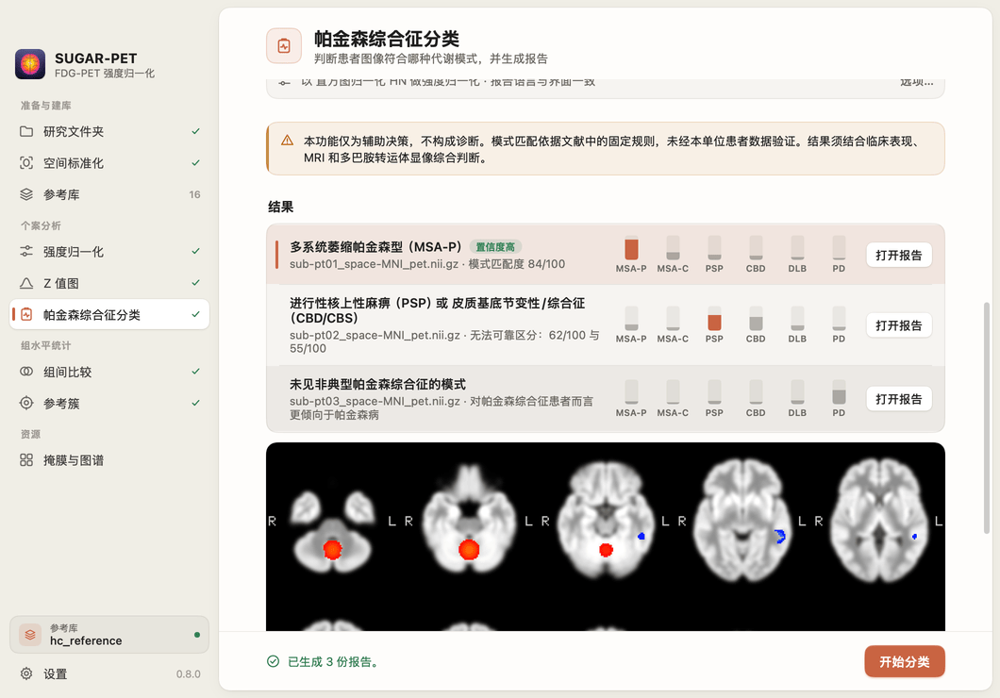
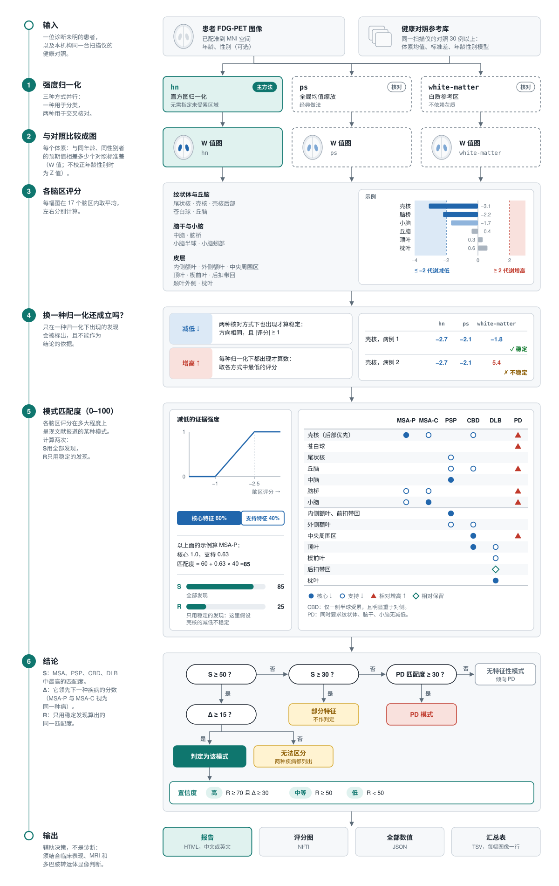

# sugar-pet

**S**tandardized **U**ptake **G**lobal **A**nd **R**egional-normalization：脑 FDG-**PET** 强度归一化工具。

[English](README.md) · [使用文档](https://lijiaxiang63.github.io/sugar-pet/zh/)

由于注射剂量、血糖水平、体重等因素的影响，不同受试者之间的脑 FDG-PET 原始体素值不能直接对比。**强度归一化**的做法是把整幅图像除以一个常数（即**归一化因子**）：

```
归一化后的图像 = 原图像 / 因子
```

各种归一化方法的区别，本质上只在于这个因子怎么估计。`sugar-pet` 集成了领域内常用的多种方法，并实现了 [López-González 等, NeuroImage 2020](https://doi.org/10.1016/j.neuroimage.2020.117229) 中基于直方图的方法（HN、iPS、iHN）。

## 安装

```bash
pip install git+https://github.com/lijiaxiang63/sugar-pet
```

用于本地开发：

```bash
git clone https://github.com/lijiaxiang63/sugar-pet && cd sugar-pet && uv sync
```

需要 Python 3.10+，核心包只依赖 numpy、scipy 和 nibabel。如果需要使用组间统计功能（`sugar-pet compare`），还需一并安装 [GrouVox](https://github.com/lijiaxiang63/GrouVox)：

```bash
pip install "sugar-pet[stats] @ git+https://github.com/lijiaxiang63/sugar-pet"
```

## 桌面应用

[`app/`](app) 目录下是配套的 SUGAR-PET 桌面应用。它与命令行版本使用同一套算法，但开箱即用，无需配置 Python 环境（只有可选的“空间标准化”页面在调用 SPM 时才需要 MATLAB）。应用体积约 12 MB，支持 macOS、Windows 和 Linux，基于 Go 和 [MyGo](https://github.com/egoist/mygo) 原生界面库编写，支持中英文界面切换。


[使用文档](https://lijiaxiang63.github.io/sugar-pet/zh/)对桌面端的每个页面都提供了详细的分步说明和截图。

左侧栏按推荐的分析顺序排列了各个功能页面：**空间标准化**、**强度归一化**、**参考库**、**Z 值图**、**帕金森综合征分类**、**组间比较**、**参考簇**以及内置的**掩膜与图谱**。文件可以直接拖放进列表。桌面端读写的目录和文件格式（参考库文件夹、`factors.tsv`、输出命名、团块报告、分类报告）与命令行版本完全一致，两者可以随时混用。

需要注意区分两个“normalisation”：**空间标准化**是指把原始空间的 PET 图像配准到 MNI 标准空间（对应 `sugar-pet spatial-norm`），需要 MATLAB 和 SPM12/SPM25（应用会自动查找 MATLAB，SPM 路径需手动指定），只有图像尚未配准到 MNI 空间时才需要这一步。**强度归一化**则是本工具的核心：将每幅图像除以各自估计出的因子，不依赖任何外部软件。

大多数分析用不着改动的选项（平滑、迭代方法、组间比较的校正方式、SPM 与 MATLAB、界面语言）都收在应用的“设置”里：点击侧边栏底部的齿轮，或按 ⌘, / Ctrl+,。

macOS、Windows 和 Linux 的预编译安装包可在[发布页](https://github.com/lijiaxiang63/sugar-pet/releases)下载。从 0.7.0 版起，应用会从发布页自动更新：启动后不久检查一次，此后每天检查一次；也可以在“设置”里点击**检查更新…**立即检查（通过 `.deb` 或 `.rpm` 安装的版本由系统的包管理器更新）。

发布新版本的步骤：把 `app/mygo.json`、`app/core/reference.go` 和 `pyproject.toml` 中的版本号改为新版本，在 [`app/CHANGELOG.md`](app/CHANGELOG.md) 中写好该版本的小节（更新窗口会显示这段内容），然后推送 `v<版本号>` 标签。[`release.yml`](.github/workflows/release.yml) 会构建各个平台、为更新包签名并发布。更新包用一对密钥签名：公钥是 `app/mygo.json` 里的 `updates.publicKey`，私钥保存在仓库的 Secret `MYGO_UPDATER_PRIVATE_KEY` 中，不在仓库里。请务必备份私钥：已安装的应用不接受用其他密钥签名的更新。

也可以用 Go 1.27+ 自行编译：

```bash
cd app
go tool mygo build        # 编译当前平台，产物输出到 build/<系统>-<架构>/
go tool mygo build -platform darwin/universal,windows/amd64,linux/amd64
go tool mygo dev          # 开发模式下直接运行
```

应用的数值核心（[`app/core`](app/core)）是 Python 包的 Go 移植版，同时内置了 GrouVox 的双样本 t 检验和多重比较校正。`app/parity/run.py` 会用两种实现分别运行相同的命令并逐项比对输出：图像数值差异在取值范围的 1e-6 量级，表格与团块报告完全一致。在 `app` 目录下执行 `go test ./...` 会用合成图像把应用各页面的完整流程跑一遍。macOS 版目前仅有临时签名、未经 Apple 公证，首次打开请右键点击并选择“打开”。

## 快速上手

输入图像必须已经**空间标准化到 MNI 空间**（体素大小和包围盒不限）。如果图像还在原始空间，请先看[图像还不在 MNI 空间？](#图像还不在-mni-空间)。

```bash
# 1. 参考区法：无需额外对照数据
sugar-pet normalize sub-01_pet.nii.gz -m cerebellum -o out/

# 2. 直方图法（推荐）：先用健康对照建一次参考库……
sugar-pet build-reference controls/*.nii.gz -o hc_reference/

# ……之后每位患者都可以直接调用它
sugar-pet normalize patients/*.nii.gz -m hn -r hc_reference/ -o out/
```

运行后，`out/` 目录下会为每幅输入生成对应的归一化图像（如 `sub-01_desc-hn_pet.nii.gz`），并附带一份记录所有因子的 `factors.tsv`。

## 方法

在终端运行 `sugar-pet methods` 可以查看完整列表。

| `-m`             | 因子的估计方式                                             | 需要对照 |
| ---------------- | ---------------------------------------------------------- | :------: |
| `whole-brain`    | 全脑平均摄取（灰质 + 白质）                                |    否    |
| `cerebellum`     | 全小脑平均摄取（文献中的 RRC）                             |    否    |
| `cerebellar-gm`  | 小脑灰质平均摄取                                           |    否    |
| `pons`           | 脑桥中央平均摄取                                           |    否    |
| `white-matter`   | 大脑深部白质平均摄取                                       |    否    |
| `occipital`      | 枕叶皮层平均摄取                                           |    否    |
| `sensorimotor`   | 初级感觉运动皮层平均摄取                                   |    否    |
| `region`         | 任意自选区域的平均摄取（通过 `--mask` 或 `--labels` 指定） |    否    |
| `ps`             | **比例缩放**：灰质掩膜内的平均摄取                         |    否    |
| `spm-global`     | SPM 全局均值（高于全图均值 1/8 的所有体素的均值）          |    否    |
| `hn`             | **直方图归一化**：图像除以对照均值图，取比值中**出现频率最高**的值 | 是 |
| `ips`            | **迭代 PS**：先做 PS，剔除低代谢体素后重做 PS              |    是    |
| `ihn`            | **迭代 HN**：先做 HN，剔除低代谢体素后重做 HN              |    是    |

支持一次传入多种方法，例如 `-m cerebellum,ps,hn` 或 `-m all`。如果只想算因子不输出图像，加上 `--factors-only` 即可。

`ps` 和 `whole-brain` 在实现上与其他参考区法一样，都是直接取指定区域的均值，只是掩膜范围不同：`ps` 只取灰质（与原文一致），`whole-brain` 则包含灰质和白质。

参考区相关的常用选项：

| 选项                 | 含义                                                             |
| -------------------- | ---------------------------------------------------------------- |
| `--mask 名称或文件`  | 指定其他区域：填入[内置掩膜](#内置掩膜)名称，或自己的 MNI 空间 NIfTI 文件 |
| `--labels 34,85`     | 用图谱标签组合出自定义区域（运行 `sugar-pet labels` 查看所有标签） |
| `--statistic median` | 取区域中位数而非均值（`ps` 也适用）                              |
| `--target 50`        | 将输出缩放到“参考值 = 50”而非默认的 1（适用于所有方法）          |

例如，原文中的另外两个参考区就可以直接调用内置掩膜：`-m region --mask brainstem`（RRBS）以及 `-m region --mask temporal-left`（RRTL，通常选病灶**对侧**）。

### 该选哪种？

根据原文的对比结论：

* **默认推荐 `hn`。** 它不需要预先假设哪些脑区未受累，在数据驱动方法中表现最好。`ihn` 算出的因子通常与 `hn` 相差无几（原因见[实现说明](#实现说明及与原文的差异)）。
* **大范围低代谢时 `ps` 存在偏差。** 病灶会拉低全脑均值，导致因子偏小，正常脑区反而显得**高**代谢。`ips` 能消除绝大部分这类偏差。
* **参考区法依赖先验假设。** 只有当参考区体积足够大且确实不受疾病影响时才可靠；像脑桥这样的小区域噪声往往较大。

不同疾病相对保留的脑区不同，下面是一些常见参考：

| 疾病                     | 不宜作参考区             | 通常相对保留             |
| ------------------------ | ------------------------ | ------------------------ |
| 阿尔茨海默病（AD）       | —                        | 小脑、脑桥、感觉运动皮层 |
| 多系统萎缩（MSA）        | 小脑、脑桥               | 枕叶皮层                 |
| 进行性核上性麻痹（PSP）  | 脑桥（邻近萎缩的中脑）   | 枕叶皮层、小脑           |
| 皮质基底节综合征（CBS）  | 感觉运动皮层             | 枕叶皮层、小脑           |
| 路易体痴呆（DLB）、PCA   | 枕叶皮层                 | 小脑、感觉运动皮层       |

以上仅作经验参考，具体研究请结合疾病分期和最新文献判断。

需要注意，`hn`、`ips` 和 `ps` 都假设**大部分**灰质是正常的。如果某种疾病导致全脑几乎所有皮层摄取都弥漫性下降，它们是看不出来的；这时建议用白质参考区或[参考簇](#参考簇)做敏感性分析。

## 推荐流程

适用于“患者组 vs. 健康对照组”的常规对比研究，设计时主要考虑了非典型帕金森综合征（MSA、PSP、CBS），这类疾病中传统参考区（小脑、脑桥）往往自身就存在病变。

`sugar-pet init study/` 会按用户指南推荐的结构建好一项研究的文件夹和一个空的 `participants.tsv`，并说明每个文件夹的作用。下面的命令从中读取 `patients/`、`controls/`、`participants.tsv` 和 `hc_reference/`：把数据放进去之后，在这个文件夹里（`cd study/`）运行它们。结果写到哪里由你决定（`-o`）；`init` 为组间比较和 Z 值图准备了 `compare/` 和 `zmaps/`。桌面应用的“研究文件夹”页面也能完成同样的操作。

**1. 统一预处理标准。** 患者和对照尽量来自同一台扫描仪、采用相同的重建参数，走同一套空间标准化流程，并且逐幅目视检查配准质量。

**2. 用全部对照建一个参考库**，同时提供年龄和性别信息：

```bash
sugar-pet build-reference controls/*.nii.gz -o hc_reference/ --covariates participants.tsv --stats-for occipital,white-matter
```

**3. 用 `hn` 做组间比较**作为主分析：

```bash
sugar-pet compare --group1 patients/*.nii.gz --group2 controls/*.nii.gz -m hn -r hc_reference/ -o stats/ --covariates participants.tsv
```

该命令会自动完成两组归一化、平滑以及纳入年龄和性别的逐体素统计检验（详见[组间比较](#组间比较)）。如果你想导出到 SPM 等其他统计软件里分析，可以先用 `sugar-pet normalize` 生成归一化图像，然后在统计软件中关闭全局缩放（例如 SPM 里不选 proportional scaling，也不选 ANCOVA），避免重复归一化。

**4. 个案分析使用 W 值图**（已校正年龄和性别）：

```bash
sugar-pet zmap patients/*.nii.gz -m hn -r hc_reference/ -o wmaps/ --covariates participants.tsv
```

对于诊断尚未明确的患者，`sugar-pet classify` 可以将这样的分布图与 MSA、PSP、CBD、DLB 和 PD 的典型模式逐一比对并输出报告，详见[帕金森综合征分类](#帕金森综合征分类)。

**5. 换用另外两种参考区重跑第 3、4 步**（先 `-m occipital`，再 `-m white-matter`），作为敏感性分析：

* `occipital`：解剖参考区，MSA、PSP、CBS 通常不累及枕叶。
* `white-matter`：不依赖“大部分灰质正常”的假设，能够检出 `hn` 看不到的弥漫性下降，但噪声相对较大。

如果结论保持一致，论文中报告 `hn` 结果并说明做过敏感性检查即可；如果结论随方法改变，则应如实说明结果对归一化方式敏感。

**论文方法部分建议写明**：所使用的归一化方法（`hn`）、对照组的例数、年龄范围与性别构成、平滑核大小（默认 8 mm），以及 `sugar-pet` 版本号。

**常见误区（建议避开）**：

* 使用疾病本身会累及的脑区作参考区（如 MSA 用小脑和脑桥、PSP 用脑桥、CBS 用感觉运动皮层）；
* 患者组和对照组采用不同的归一化方法；
* 两组年龄存在差异时直接看未校正的普通 Z 值；
* 用同一批患者生成[参考簇](#参考簇)，再拿它来检验这批患者自己。

## 健康对照参考库

`hn`、`ips` 和 `ihn` 需要将每幅受试者图像与健康对照组进行比较。`sugar-pet build-reference` 会将对照组汇总成一个结构紧凑的文件夹：

| 文件               | 内容                                                  |
| ------------------ | ----------------------------------------------------- |
| `template.nii.gz`  | 对照组经比例缩放后的均值图（HN 的“正常模板”）         |
| `ps_std.nii.gz`    | 对照组经 PS 归一化后的标准差图                        |
| `hn_mean.nii.gz`、`hn_std.nii.gz` | 对照组经 HN 归一化后的均值与标准差图   |
| `mask.nii.gz`      | 估计因子所用的体素范围（灰质掩膜）                    |
| `reference.json`   | 对照例数、平滑核大小及每例对照的因子                  |
| `stats-<方法>_mean.nii.gz`、`..._std.nii.gz` | 仅在使用 `--stats-for` 时生成：对照经其他方法归一化后的均值与标准差（用于 [Z 值图](#z-值图)） |
| `model-<方法>_beta.nii.gz`、`..._sd.nii.gz` | 仅在使用 `--covariates` 时生成：摄取与年龄、性别的回归参数（用于 [W 值](#校正年龄和性别w-值)） |

对照组应与患者来自同一台扫描仪、采用相同的重建参数并经过一致的预处理，建议不少于 20 例。

默认情况下，对照和后续的每幅患者图像都会先用 8 mm 高斯核平滑，但这**只用于估计归一化因子**；最终写出的归一化图像是原图除以因子，本身不会被平滑。如果输入图像在导入前已经平滑过，请给两个命令都加上 `--fwhm 0`。

## 迭代方法的选项

| 选项              | 默认值  | 含义                                                         |
| ----------------- | ------- | ------------------------------------------------------------ |
| `--p-threshold`   | `0.01`  | 与对照相比未校正 p 值小于该阈值的体素会被剔除                |
| `--exclude`       | `hypo`  | `hypo`：仅剔除低代谢体素（原文做法）；`both`：同时剔除高代谢体素 |
| `--max-iter`      | `1`     | 重新估计的迭代次数（原文为 1）                               |
| `--save-masks`    | 关      | 同时保存估计每个因子时实际用到的体素掩膜                     |

## Z 值图

Z 值图用于逐体素衡量归一化后的图像偏离对照的程度：`z = (图像 − 对照均值) / 对照标准差`，负值表示摄取低于对照。

```bash
sugar-pet zmap patients/*.nii.gz -m hn -r hc_reference/ -o zmaps/
```

输出文件名为 `sub-01_desc-hn_zmap.nii.gz`。计算前，输入图像会按照与对照组相同的方式进行平滑。`ps`、`ips`、`hn` 和 `ihn` 可以直接使用任何参考库；但如果要用参考区法（如 `cerebellum`、`pons`）算 Z 值图，建库时必须提前用 `--stats-for` 保存对应的统计量：

```bash
sugar-pet build-reference controls/*.nii.gz -o hc_reference/ --stats-for cerebellum,pons
sugar-pet zmap patients/*.nii.gz -m pons -r hc_reference/ -o zmaps/
```

（传 `--stats-for all` 可一次性保存所有参考区的统计量。）

### 校正年龄和性别（W 值）

脑内 FDG 摄取会随年龄变化，男女之间也存在轻微差异。如果患者普遍比对照组年龄大，普通 Z 值会把衰老效应和疾病效应混在一起。W 值则将每位患者与“对照组中**同年龄、同性别**人群的预期摄取”作比较：`w = (图像 − 模型预测值) / 对照组残差标准差`。

建参考库时传入对照的协变量表，算图时传入患者的协变量表即可：

```bash
sugar-pet build-reference controls/*.nii.gz -o hc_reference/ --covariates controls.tsv
sugar-pet zmap patients/*.nii.gz -m hn -r hc_reference/ -o wmaps/ --covariates patients.tsv
```

输出文件名为 `sub-01_desc-hn_wmap.nii.gz`。不传 `--covariates` 时，`zmap` 仍可复用同一个参考库输出普通 Z 值图。

协变量表支持 TSV 或 CSV 格式，例如 BIDS 规范的 `participants.tsv`：

```
participant_id	age	sex
sub-01	63	F
sub-02	58	M
```

每幅图像按 `participant_id` 自动匹配对应行（如 `sub-01` 对应 `sub-01_..._pet.nii.gz`），也可以用 `image` 列直接写明文件名。程序只会读取参与校正的列。默认 `--adjust-for age,sex`，任何连续数值列或恰好包含两种取值的分类列都可以纳入。年龄按线性关系建模；如果患者年龄超出对照组的年龄范围，程序会给出提示。

## 帕金森综合征分类

面对诊断尚未明确的患者，`sugar-pet classify` 会找出其摄取显著低于或高于对照的脑区，评估这种分布与几种常见帕金森综合征代谢模式的匹配度，并生成可视化报告：

```bash
sugar-pet build-reference controls/*.nii.gz -o hc_reference/ --covariates controls.tsv --stats-for white-matter
sugar-pet classify sub-01_pet.nii.gz -r hc_reference/ -o reports/ --covariates patients.tsv --lang zh
```

| `reports/` 中的文件              | 内容                                                        |
| -------------------------------- | ----------------------------------------------------------- |
| `sub-01_report.html`             | 独立 HTML 报告（`--lang` 可选 `en` 或 `zh`），不依赖外部资源，可在浏览器中直接打印为 PDF |
| `sub-01_desc-hn_wmap.nii.gz`     | 生成报告所依据的偏离图（未传 `--covariates` 时为 `_zmap`）  |
| `sub-01_classification.json`     | 报告中所有的结构化数值：脑区得分、模式评分、结论            |
| `classification.tsv`             | 汇总表，每幅图像一行，记录最终结论与各模式的匹配度          |

输出文件按输入图像的主文件名命名（`sub-01_pet.nii.gz` 对应 `sub-01`）。如果不同目录的两幅图像会映射到相同的文件名（例如 `a/pet.nii.gz` 和 `b/pet.nii.gz`），程序会在写入任何文件之前直接报错退出，防止互相覆盖。

在[桌面应用](#桌面应用)中，这对应“帕金森综合征分类”页面，可直接列出每位患者的结论并一键打开报告。



**注意：这是科研辅助决策工具，不能代替临床诊断。** 现行临床诊断标准（MSA 2022、PSP 2017、DLB 2017）均只将 FDG-PET 作为支持性证据；内置规则整理自文献，并未在你的患者队列上拟合或验证过。实际判读需结合临床表现、结构 MRI 和多巴胺转运体显像。

整个判定流程如下：



具体步骤说明：

1. **生成与对照比较的偏离图。** 图像先转化为 [W 值图](#校正年龄和性别w-值)（未传 `--covariates` 时为 Z 值图），默认采用 `hn`：因为对于诊断未明的患者，无法提前指定哪个脑区未受累，而 `hn` 不需要预先指定参考区。
2. **计算各脑区评分。** 在 17 个预设脑区上分别计算左右两侧的均值：尾状核、壳核及其后部、苍白球、丘脑、中脑、脑桥、小脑半球和蚓部、内侧与外侧额叶、中央周围区、顶叶、楔前叶、后扣带回、颞叶外侧和枕叶皮层。评分 ≤ −2 记为代谢减低，≥ 2 记为代谢增高。脑区至少有一半体积落在图像有效范围内才会参与评分。
3. **跨归一化方式交叉核对。** 默认还会用比例缩放（`ps`）复核一遍；如果建参考库时加上了 `--stats-for white-matter`，还会一并用白质参考区核对（建议加上，它不依赖灰质假设）。其他方式下未能重现的异常会在报告中标出。其中，**代谢增高**只有在所有归一化方式下都成立时才会被采信，因为全局缩放很容易让未受累的正常脑区显得“相对高代谢”（[Borghammer 等，2009](https://www.sciencedirect.com/science/article/abs/pii/S1053811908008896)）。
4. **模式匹配打分。** 每种模式按 0 ~ 100 分计，核心特征占 60%，支持特征占 40%。

| 模式    | 核心特征 | 支持特征 |
| ------- | -------- | -------- |
| MSA-P   | 壳核 ↓（以后部为著） | 脑桥 ↓、小脑 ↓ |
| MSA-C   | 小脑 ↓ | 脑桥 ↓、壳核 ↓ |
| PSP     | 中脑 ↓、内侧额叶及前扣带回 ↓ | 尾状核 ↓、丘脑 ↓、额叶外侧 ↓ |
| CBD/CBS | 一侧中央周围区和顶叶皮层 ↓，且明显重于对侧 | 同侧丘脑 ↓、壳核 ↓、额叶外侧 ↓ |
| DLB     | 枕叶皮层 ↓ | 顶叶皮层 ↓、楔前叶 ↓、后扣带回相对保留（岛征） |
| PD      | 壳核、苍白球、丘脑、脑桥、小脑、感觉运动皮层 ↑ | 纹状体、脑干、小脑无减低 |

最终结论分为五种情况：

* **某一模式**：某模式得分 ≥ 50，且领先次高疾病至少 15 分（得分 ≥ 70 且领先 ≥ 30 时置信度为“高”，否则为“中等”；MSA-P 与 MSA-C 视为同一种疾病）。置信度仅依据在所有归一化方式下都成立的发现来评定：如果仅靠这些稳健发现得分不足 50，置信度会降为“低”并在报告中注明；
* **无法区分**：两种疾病得分接近，两者都会一并列出；
* **部分特征**：得分在 30 到 50 之间，尚不足以判定为该模式；
* **PD 模式**：未见非典型帕金森综合征的模式，但存在帕金森病典型的相对代谢增高；
* **未见模式**：对于有帕金森症状的患者而言，这通常更倾向于 PD（早期 PD 图像常接近正常）。

| 选项           | 默认值  | 含义                                                           |
| -------------- | ------- | -------------------------------------------------------------- |
| `-m`           | `hn`    | 分类所依据的主归一化方式                                       |
| `--check`      | `ps`，参考库有时加 `white-matter` | 用于交叉核对的其他归一化方式，或设为 `none` |
| `--covariates` | 无      | 含患者年龄、性别的表格（输出 W 值）                            |
| `--lang`       | `en`    | 报告语言：`en` 或 `zh`                                         |

对照组应来自同一台扫描仪和重建方式，采集条件与患者一致（同为睁眼或闭眼）；单病例分析建议不少于 30 例，不足时报告中会给出提示。

**为什么采用规则匹配，而不是训练好的分类器？** 现有的已验证算法大多依赖无法随开源软件分发的组件：疾病相关协方差模式（如 PDRP、MSARP、PSPRP；[Tang 等，2010](https://doi.org/10.1016/S1474-4422(10)70002-8)）不公开发布，且需要在每台扫描仪上重新推导与验证；深度学习模型的权重也大多未公开，且高度依赖扫描仪和重建参数。相比之下，每个中心都能独立完成的，是将单个患者与本中心的健康对照作比较，再对照已发表的典型模式来读片——这正是临床核医学科目视判读[单例 SPM 图](https://doi.org/10.1111/ene.13269)的常规做法。`sugar-pet classify` 只是把这一读片逻辑固化成可重复的量化流程，并把用到的每一个数值透明地列出来。

## 参考簇

除了从图谱里挑选参考区，还可以让一组患者的数据自己指出哪些体素未受疾病影响（[Yakushev 等, 2009](https://doi.org/10.1016/j.neuroimage.2008.07.015)）。做完比例缩放后，未受累的正常区域相对于对照会显得“高代谢”，因为病灶拉低了全脑均值。将这些体素提取出来就可以作为参考区：

```bash
sugar-pet reference-cluster patients/*.nii.gz -r hc_reference/ -o cluster.nii.gz
sugar-pet normalize patients/*.nii.gz -m region --mask cluster.nii.gz -o out/
```

通过 `--p-threshold`（默认 0.001，未校正）和 `--min-cluster`（默认 1 mL）可以控制保留哪些体素。

需要注意，参考簇依赖于生成它的那组患者。如果再用同一批患者与对照组作比较就属于循环论证，应当用另一批独立患者提取参考簇，或者做交叉验证。

## 组间比较

```bash
sugar-pet compare --group1 patients/*.nii.gz --group2 controls/*.nii.gz -m hn -r hc_reference/ -o stats/ --covariates participants.tsv
```

运行这一条命令会自动完成下面几步：

1. 用同一种方法归一化两组的所有图像；
2. 空间平滑（默认 8 mm）；
3. 在每个体素上执行纳入年龄和性别的双样本 t 检验；
4. 进行多重比较校正，并输出通过校正的显著团块及其解剖脑区位置。

统计检验由 [GrouVox](https://github.com/lijiaxiang63/GrouVox) 完成（安装方式见[安装](#安装)）。对比方向固定为“第 1 组减第 2 组”，因此把患者放在第 1 组时，**负 T 值代表低代谢**。

| `stats/` 中的文件                        | 内容                                             |
| ---------------------------------------- | ------------------------------------------------ |
| `group1_vs_group2_T.nii.gz`              | 未设阈值的原始 T 值图                            |
| `ClusterThresholded_group1_vs_group2_T.nii.gz` | 仅保留通过校正的显著团块的 T 值图          |
| `ClusterReport_group1_vs_group2_T.csv`   | 团块列表：体素数、峰值坐标、AAL 和 Harvard-Oxford 脑区 |
| `group1_vs_group2_factors.tsv`           | 每幅图像的归一化因子                             |
| `group1_vs_group2_mask.nii.gz`           | 实际参与检验的体素掩膜                           |
| `group1_vs_group2_beta.nii.gz`、`..._cohen_f2.nii.gz` | 模型回归系数与效应量（Cohen's f²）  |

| 选项               | 默认值             | 含义                                                     |
| ------------------ | ------------------ | -------------------------------------------------------- |
| `--covariates`     | 无                 | 一个或多个协变量表，需覆盖所有图像，如患者和对照各一张表（[格式](#校正年龄和性别w-值)） |
| `--adjust-for`     | `age,sex`          | 纳入回归模型的协变量列                                   |
| `--correction`     | `grf`              | `grf`：团块水平校正（`--voxel-p 0.001`、`--cluster-p 0.05`）；`fdr`：体素水平（`--q 0.05`）；`none`。均为双侧检验 |
| `--analysis-mask`  | `gray-matter`      | 参与检验的体素范围：内置掩膜或自定义文件                 |
| `--fwhm`           | 与参考库相同       | 平滑核（mm）；图像已平滑过则设为 0                       |
| `--name`           | `group1_vs_group2` | 输出文件的前缀                                           |
| `--keep-images`    | 关                 | 保留参与检验的归一化、平滑后的中间图像                   |

注意不要重复纳入同一位受试者，双样本 t 检验要求样本之间相互独立。

## Python 接口

```python
from sugar_pet import Reference, normalize, zmap

ref = Reference.build(control_files, fwhm=8)  # 或 Reference.load("hc_reference")
ref.save("hc_reference")

res = normalize("sub-01_pet.nii.gz", method="ihn", reference=ref)
print(res.factor)  # 归一化因子
print(res.info)    # 所用体素数、被剔除的比例等
res.save("sub-01_desc-ihn_pet.nii.gz")
res.mask_image()   # 估计因子所用的体素掩膜

z = zmap("sub-01_pet.nii.gz", method="ihn", reference=ref)  # 返回 NIfTI 图像对象

# W 值：建库时传入对照协变量，算图时传入患者协变量
ref = Reference.build(control_files, covariates={"age": ages, "sex": sexes})
w = zmap("sub-01_pet.nii.gz", method="ihn", reference=ref, covariates={"age": 63, "sex": "F"})
```

对单个患者做[帕金森综合征分类](#帕金森综合征分类)：

```python
from sugar_pet import classify

res = classify("sub-01_pet.nii.gz", reference=ref, covariates={"age": 63, "sex": "F"})
res.conclusion          # {'category': 'pattern', 'pattern': 'msa-p', 'confidence': 'high', ...}
res.result["regions"]   # 每个脑区、左右两侧在各归一化方式下的评分
res.result["patterns"]  # 与每种模式的匹配度及其依据
res.zmap                # 偏离图（NIfTI 图像对象）
res.save("reports", "sub-01", lang="zh")  # 保存图、报告与数据
```

参考区支持内置掩膜、自定义文件或内置图谱的任意标签组合：

```python
from sugar_pet import atlas_labels, labels_mask, reference_cluster

res = normalize(img, "region", mask="brainstem", statistic="median", target=100)

atlas_labels()  # {21: 'Putamen (R)', 72: 'Putamen (L)', ...}
res = normalize(img, "region", mask=labels_mask([40, 91]))  # 双侧丘脑

cluster = reference_cluster(patient_files, ref)
res = normalize(img, "region", mask=cluster)
```

组间比较（需要安装 GrouVox）：

```python
from sugar_pet import compare_groups

ages, sexes = patient_ages + control_ages, patient_sexes + control_sexes  # 第 1 组在前
res = compare_groups(patient_files, control_files, "stats", "hn", reference=ref, covariates={"age": ages, "sex": sexes})
print(res.n_clusters, res.files["cluster_report"])
```

## 内置掩膜

内置掩膜包括：`gray-matter`、`parenchyma`、`cerebellum`、`cerebellar-gm`、`pons`、`white-matter`、`occipital`、`sensorimotor`、`brainstem`、`temporal-left`、`temporal-right`。运行 `sugar-pet masks -o masks/` 可以将它们导出为 NIfTI 文件方便查看，`sugar-pet labels` 则列出 `--labels` 可用的全部图谱标签。

这些掩膜制作自两个可自由再分发的 MNI 资源（已重采样到 2 mm）：ICBM 2009c 组织概率图和 [CerebrA 图谱](https://doi.org/10.1038/s41597-020-0557-9)，使用时会自动重采样到每幅输入图像的网格。

其中，脑桥掩膜取自 CerebrA 脑干在 z = −44 到 −26 mm 之间的部分并做了层面内腐蚀，是一个实用的脑桥中央区，而非解剖学金标准；`occipital` 覆盖整个枕叶皮层，如果只需要枕叶外侧皮层，请用 `--labels 34,85`。如果你的研究使用其他 MNI 版本或图谱，建议传入自定义的掩膜文件。

## 图像还不在 MNI 空间？

你可以用任何顺手的工具做空间标准化（SPM、ANTs 等）。如果手头只有 PET（没有配套 MRI）且本机装有 SPM，可以直接使用包里自带的小封装（底层调用 SPM “Old Normalise” + PET 模板，需要 MATLAB）：

```bash
sugar-pet spatial-norm raw/*_pet.nii.gz -o mni/ --spm-path /path/to/spm12 --jobs 4
```

它会自动围绕头部裁剪图像、将原点移到大脑中心，然后输出 2 mm 的 MNI 空间图像。配准完成后请务必逐幅目视检查。桌面端的**空间标准化**页面执行的是完全相同的流程。

## 实现说明及与原文的差异

* **HN。** 在灰质掩膜内计算比值图（受试者 / 模板），取比值直方图的峰值作为因子。由于直接取直方图最大值会受分箱宽度影响，程序会先用高斯核平滑直方图（核密度估计）再找峰。
* **剔除异常体素。** 原文使用 SPM 的双样本 t 检验（单个患者 vs. 对照组）。`sugar-pet` 直接计算等价的等方差 t 统计量 `t = (x − 均值) / (标准差 · √(1 + 1/n))`（自由度 n − 1），因此无需依赖 SPM。
* **iPS。** 剔除部分体素后，剩余体素在对照组中的均值通常不再严格等于 1。因此 `sugar-pet` 用受试者均值除以对照模板在**同一批剩余体素**上的均值。如果想严格按原文字面公式直接取均值，可以加上 `--literal-ips`。
* **iHN ≈ HN。** 低代谢体素大多落在比值直方图的尾部，离主峰很远，去掉它们几乎不移动峰的位置。因此 `hn` 和 `ihn` 的因子通常只差千分之几，这种抗干扰性正是 HN 好用的原因。
* **尺度统一。** `ps`、`ips`、`hn` 和 `ihn` 都标定在“健康大脑灰质掩膜均值约为 1”的尺度上。
* **参考簇。** 双样本 t 检验（患者 > 对照，等方差）直接利用患者图像和参考库里保存的均值、标准差计算，无需重复读取对照图像。
* **W 值。** 在每个体素上，将归一化后的对照图像对协变量做普通最小二乘回归。与 [La Joie 等, 2012](https://doi.org/10.1523/JNEUROSCI.2170-12.2012) 一致，残差直接除以对照组的残差标准差，不额外加入预测不确定性项。
* **为什么不做零均值单位方差标准化？** 深度学习预处理常用的 z-score 标准化既平移又缩放，会破坏 PET 的摄取比值。至于 SSM/PCA 协方差分析中的对数变换和双中心化，本身就属于该分析方法的一部分，且事先怎么做线性缩放都不会影响最终结果。

在模拟图像测试中（大范围皮层病灶、代谢下降 40%，见 `tests/`），各方法的因子误差分别为：`ps` −3.7%，`ips` −0.5%，`hn` 和 `ihn` 均小于 0.1%，排序与原文报告一致。

## 开发

```bash
uv sync
uv run pytest
uv run ruff check .
```

* `scripts/build_atlas.py`：用于从 MNI 原始下载文件重新生成内置图谱。
* `scripts/classify_flowchart.py`：用于重绘分类流程图（`docs/classify-flow-en.svg` 和 `-zh.svg`）；图中的阈值硬编码在脚本里，修改 `classify.py` 中的阈值后记得同步更新。
* 分类报告的文案和样式表（`classify_text.json`、`report.css`）位于 `src/sugar_pet/data`，桌面端在 `app/core/data` 下有一份副本；两者不一致时测试会报错。

[使用文档](https://lijiaxiang63.github.io/sugar-pet/zh/)是位于 [`docs/`](docs) 的 VitePress 站点，包含英文和中文（`docs/zh`）两个版本：

```bash
cd docs
npm install
npm run dev               # 在 http://localhost:5173/sugar-pet/ 本地预览
sh scripts/screenshots.sh # 调用桌面应用重新截取文档截图（需要 Go 和 pngquant）
```

向 `main` 分支推送涉及 `docs/` 的改动时，GitHub Actions 会自动构建并部署到 GitHub Pages（[`docs.yml`](.github/workflows/docs.yml)）。

## 参考文献

* López-González FJ, Silva-Rodríguez J, Paredes-Pacheco J, et al. Intensity
  normalization methods in brain FDG-PET quantification. *NeuroImage* 2020;222:117229.
* Yakushev I, Hammers A, Fellgiebel A, et al. SPM-based count normalization
  provides excellent discrimination of mild Alzheimer's disease and amnestic
  mild cognitive impairment from healthy aging. *NeuroImage* 2009;44:43–50.
* La Joie R, Perrotin A, Barré L, et al. Region-specific hierarchy between
  atrophy, hypometabolism, and β-amyloid (Aβ) load in Alzheimer's disease
  dementia. *J Neurosci* 2012;32:16265–16273.
* Manera AL, Dadar M, Fonov V, Collins DL. CerebrA, registration and manual
  label correction of Mindboggle-101 atlas for MNI-ICBM152 template.
  *Sci Data* 2020;7:237.
* Fonov V, Evans AC, Botteron K, et al. Unbiased average age-appropriate
  atlases for pediatric studies. *NeuroImage* 2011;54:313–327.
* Meyer PT, Frings L, Rücker G, Hellwig S. 18F-FDG PET in parkinsonism:
  differential diagnosis and evaluation of cognitive impairment.
  *J Nucl Med* 2017;58:1888–1898.
* Caminiti SP, Alongi P, Majno L, et al. Evaluation of an optimized
  [18F]fluoro-deoxy-glucose positron emission tomography voxel-wise method to
  early support differential diagnosis in atypical Parkinsonian disorders.
  *Eur J Neurol* 2017;24:687–e26.
* Tang CC, Poston KL, Eckert T, et al. Differential diagnosis of parkinsonism:
  a metabolic imaging study using pattern analysis. *Lancet Neurol* 2010;9:149–158.
* Niethammer M, Tang CC, Feigin A, et al. A disease-specific metabolic brain
  network associated with corticobasal degeneration. *Brain* 2014;137:3036–3046.
* Borghammer P, Cumming P, Aanerud J, Gjedde A. Artefactual subcortical
  hyperperfusion in PET studies normalized to global mean: lessons from
  Parkinson's disease. *NeuroImage* 2009;45:249–257.
* Wenning GK, Stankovic I, Vignatelli L, et al. The Movement Disorder Society
  criteria for the diagnosis of multiple system atrophy. *Mov Disord* 2022;37:1131–1148.
* Höglinger GU, Respondek G, Stamelou M, et al. Clinical diagnosis of
  progressive supranuclear palsy: the Movement Disorder Society criteria.
  *Mov Disord* 2017;32:853–864.
* McKeith IG, Boeve BF, Dickson DW, et al. Diagnosis and management of dementia
  with Lewy bodies: fourth consensus report of the DLB Consortium.
  *Neurology* 2017;89:88–100.

## 许可

代码部分采用 MIT 许可；内置图谱文件适用 [`src/sugar_pet/data/LICENSE-MNI`](src/sugar_pet/data/LICENSE-MNI) 中的 MNI 许可。本工具仅供科研使用，不作为医疗器械。
