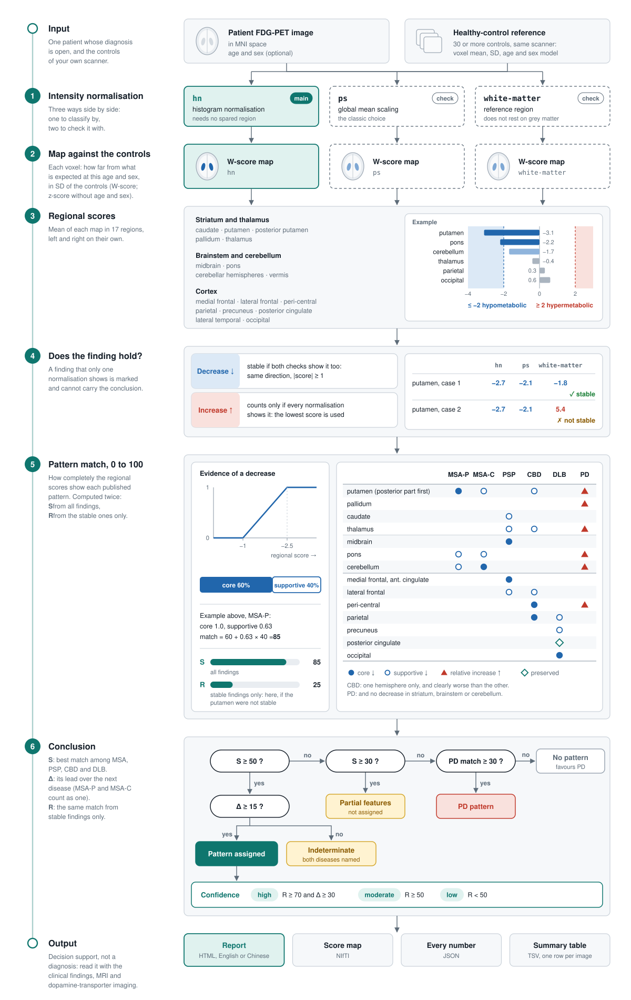

# Step 5: Classify parkinsonism

**Page: Classify Parkinsonism** · needs the reference

For a patient with an uncertain diagnosis, this page identifies brain regions
where uptake is lower or higher than in healthy controls, evaluates how closely
that pattern matches major parkinsonian syndromes, and generates a report.

::: warning Decision aid, not a clinical diagnosis
Current diagnostic criteria (MSA 2022, PSP 2017, DLB 2017) treat FDG-PET as
supportive evidence only. The rules implemented here come from published
literature and have not been fitted to or validated on your patients. Always
interpret the report alongside clinical findings, structural MRI, and
dopamine-transporter imaging.
:::

## Before you start

* The reference from [Step 2](./build-reference). For single-patient
  classification, 30 or more controls are recommended, acquired under the same
  conditions (eyes open or closed) as the patients.
* Whenever possible, build the reference with a **covariate table** and with
  **White matter** ticked: the former adjusts scores for age and sex, and the
  latter adds a cross-check that does not depend on gray matter.

## Fill in the page

<Shot name="classify" alt="The Classify Parkinsonism page, filled in" :marks="[[1, 120], [2, 328], [3, 376], [4, 472], [5, 520], [6, 567], [7, 621]]" />

1. **Add the patient images** (in MNI space, one per patient).
2. **Reference:** already filled in. The status line beneath it warns if
   fewer than 30 controls are available.
3. **Covariate table:** select `participants.tsv` so each patient is compared
   against controls of the same age and sex.
4. **Intensity normalisation:** keep **Histogram (HN)**. It requires no prior
   assumption about which regions are spared, making it well suited to
   undiagnosed cases.
5. **Checked with:** read-only reminder of the secondary normalisations used
   for cross-checking—always PS, plus white matter if included in the
   reference.
6. **Language of the report:** match the app, English, or Chinese.
7. **Output folder:** Ada selects `study/reports/`.

Scroll down, then click **Classify**.

<Shot name="classify-results" alt="The results of the classification" :marks="[[8, 'run'], [9, 497]]" />

8. Click **Classify**.
9. **Results:** one row per patient, showing the conclusion in bold and the
   pattern scores below it. Click **Open Report** to view that patient's
   report in your browser.

## Reading the conclusion

| Conclusion | Meaning |
| --- | --- |
| **A pattern**, e.g. *Multiple system atrophy, parkinsonian type (MSA-P)* | One pattern scores at least 50 out of 100 and leads the next disease by at least 15 points. Confidence is *high* for scores ≥ 70 with a lead ≥ 30, otherwise *moderate*; it drops to *low* if the supporting findings do not hold across all checked normalisations |
| ***A* or *B*** | Two syndromes score closely; both are listed |
| **Partial features of…** | Highest score falls between 30 and 50—suggestive, but not strong enough to assign a pattern |
| **PD pattern** | No atypical parkinsonism pattern is present, but relative increases typical of Parkinson's disease are |
| **No pattern of atypical parkinsonism** | In a patient with parkinsonism, this favours Parkinson's disease, whose FDG-PET scan is often near normal early on |

## The report

The report is a standalone HTML file with no external dependencies. It shows
the deviation map, left and right scores for all 17 regions, the match and
supporting features for every pattern, and the final conclusion with caveats.
Print it to PDF directly from your browser (**File › Print**).

## Output files

In the output folder, named after each input image:

| File | Description |
| --- | --- |
| `sub-pt01_space-MNI_report.html` | Standalone HTML report |
| `sub-pt01_space-MNI_desc-hn_wmap.nii.gz` | Underlying deviation map (`_zmap` when no covariate table is given) |
| `sub-pt01_space-MNI_classification.json` | All numerical outputs from the report (regions, patterns, conclusion) |
| `classification.tsv` | Summary table with one row per image: conclusion and pattern scores |

## How the conclusion is reached



1. **Compute a deviation map.** The image is converted into a W-score map (or
   Z-score map without covariates) using HN.
2. **Score each region.** Mean map values are extracted across 17 regions
   separately for left and right hemispheres. Scores ≤ −2 count as reduced;
   scores ≥ 2 count as increased.
3. **Cross-check across normalisations.** Any finding that disappears under
   PS (or white-matter normalisation) is flagged. An *increase* only counts if
   it holds under every normalisation, because global scaling makes spared
   regions appear hypermetabolic.
4. **Match against patterns.** Each syndrome is scored from 0 to 100, with
   core features weighted at 60% and supportive features at 40%.

| Pattern | Core features | Supportive features |
| --- | --- | --- |
| MSA-P | Putamen ↓ (posterior first) | Pons ↓, cerebellum ↓ |
| MSA-C | Cerebellum ↓ | Pons ↓, putamen ↓ |
| PSP | Midbrain ↓, medial frontal and anterior cingulate ↓ | Caudate ↓, thalamus ↓, lateral frontal ↓ |
| CBD/CBS | Pericentral and parietal cortex ↓ asymmetrically (clearly worse on one side) | Ipsilateral thalamus ↓, putamen ↓, lateral frontal ↓ |
| DLB | Occipital cortex ↓ | Parietal ↓, precuneus ↓, posterior cingulate relatively spared |
| PD | Putamen, pallidum, thalamus, pons, cerebellum, sensorimotor cortex ↑ | No reduction in striatum, brainstem, or cerebellum |

::: details The same from the command line
```bash
sugar-pet classify patients/*.nii.gz -r hc_reference/ -o reports/ --covariates participants.tsv --lang en
```
:::

## Next

[Step 6: Compare two groups](./compare).
