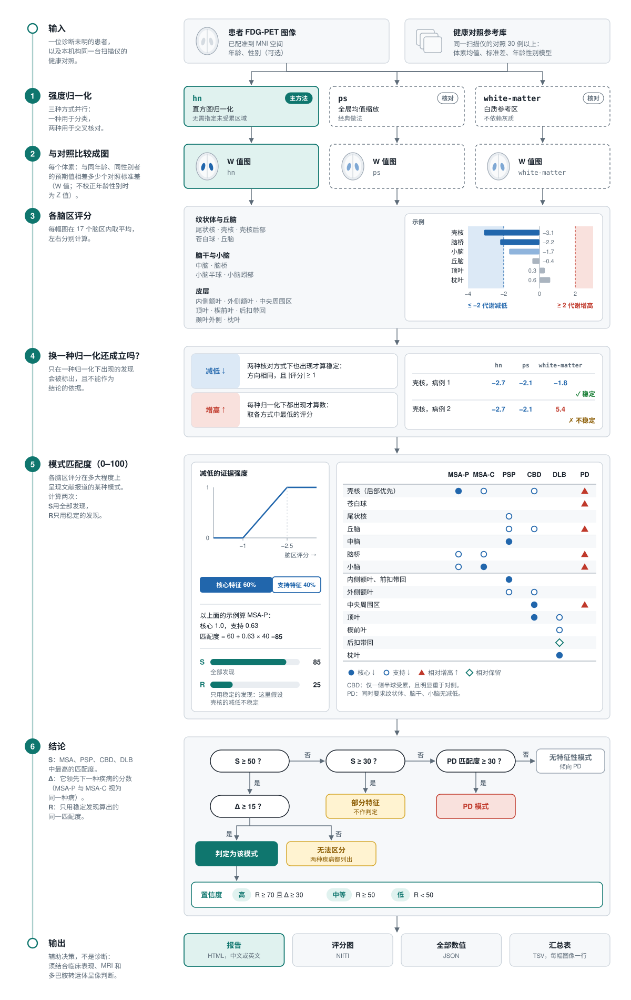

# 帕金森综合征分类

**页面：帕金森综合征分类** · 个案分析第 3 步

对于诊断尚不明确的患者，这一步找出摄取低于或高于健康对照的脑区，评估这种模式与几种主要帕金森综合征的吻合程度，并生成报告。

::: warning 辅助决策，不是诊断
现行诊断标准（MSA 2022、PSP 2017、DLB 2017）只把 FDG-PET 作为支持性证据。这里的规则来自文献，既没有在你的患者上拟合，也没有在你的患者上验证。请始终结合临床表现、结构 MRI 和多巴胺转运体显像来解读报告。
:::

## 开始之前

* 已完成[第 1 步](./normalize)和[第 2 步](./zmap)：分类读取第 2 步生成的图。
* 用于单例患者时，建议对照不少于 30 例，且采集条件（同为睁眼或同为闭眼）与患者一致。
* 条件允许时，为项目提供**协变量表**，让评分校正年龄和性别；并在[设置](./normalize#control-statistics-options)的*其他方法的对照统计*中勾选**深部白质**，让交叉验证多一种不依赖灰质的归一化方式。

## 运行

这一步读取第 2 步为每例患者生成的偏离图，不再询问任何内容，也不会重新归一化或制图。第 2 步还没运行，或它之前的内容此后有变化时，页面会说明，**开始分类**按钮也不可用。

<Shot name="classify" alt="“帕金森综合征分类”页面" :marks="[[1, 109], [2, 234], [3, 275], [4, 316], [5, 357], [6, 491], [7, 560], [8, 'run']]" />

1. **步骤条**：打勾表示该步已完成。
2. **图像**：第 2 步生成了图的患者。
3. **方法**：分类所依据的第 1 步主方法，以及开启交叉验证时用来核对的归一化方法。建议保留**直方图归一化 HN**：它不预设哪些区域未受累，适合诊断未明的病例。
4. **健康对照**：对照人数；页面建议不少于 30 例。
5. **协变量表**：评分是否校正年龄和性别。要修改以上任何一项，点**返回第 2 步修改**。
6. **输出位置**：项目的 `reports` 文件夹。
7. **当前生效的选项**：报告语言和交叉验证。**选项…**打开**设置 › 帕金森综合征分类**（见下文）。
8. 点击**开始分类**。

### 选项 {#options}

<Shot name="settings-classify" alt="设置 › 帕金森综合征分类" />

* **用另一种归一化方法交叉验证**：关闭时，分类只读取第 2 步的图，不重新计算任何东西。开启时，每个发现还会在全局缩放（PS）的图上核对；对照统计包含深部白质时，也在深部白质归一化的图上核对。第 2 步没有生成的图会在这里计算，耗时更长。其他归一化方式下不成立的发现会在报告中标出，对模式评分的贡献也更小。
* **报告语言**：与界面一致、英文或中文。

## 检查结果

<Shot name="classify-results" alt="分类的结果" :marks="[[9, 184], [10, 940, 184]]" />

9. **每例患者一行**：加粗的是结论，结论为某种模式时附有置信度；下方是图像名称和得出结论的依据。旁边的条形显示六种模式（MSA-P、MSA-C、PSP、CBD、DLB、PD）各自的得分（0 到 100），领先的模式以彩色显示。像第二例患者那样两条高度相近，说明这两种综合征无法区分。
10. **打开报告**在浏览器中显示该患者的报告。

滚动到页面底部。

<Shot name="classify-figure" alt="一例患者的偏离图" :marks="[[11, 742], [12, 268, 782]]" />

11. **图片**在所选患者自己图像的横断面切片上显示其偏离图：蓝色到青色表示摄取低于对照，红色到黄色表示高于对照。点击一行可以切换到该患者。
12. **在访达中显示**打开 `reports` 文件夹。

## 解读结论 {#reading-the-conclusion}

| 结论 | 含义 |
| --- | --- |
| **某种模式**，如*多系统萎缩帕金森型（MSA-P）* | 该模式得分至少 50（满分 100），且领先第二名至少 15 分。得分 ≥ 70 且领先 ≥ 30 时置信度为*高*，否则为*中等*；它所依据的发现在所核对的归一化方式下不全成立时，降为*低* |
| ***A* 或 *B*** | 两种综合征得分接近，两者都列出 |
| **…的部分特征** | 最高得分在 30 到 50 之间：有提示，但不足以归为某种模式 |
| **PD 模式** | 没有非典型帕金森综合征的模式，但有帕金森病典型的相对增高 |
| **未见非典型帕金森综合征的模式** | 对有帕金森症状的患者，这更支持帕金森病，其早期图像常接近正常 |

## 报告

报告是一个不依赖任何其他文件的 HTML 文件，包含偏离图、17 个脑区左右两侧的评分、每种模式的匹配度和支持依据，以及结论和注意事项。可以在浏览器中打印为 PDF（**文件 › 打印**）。

## 输出文件

在 `reports/` 中，按每幅图像命名：

| 文件 | 内容 |
| --- | --- |
| `sub-pt01_space-MNI_report.html` | 报告 |
| `sub-pt01_space-MNI_classification.json` | 报告中的所有数值：脑区、模式、结论 |
| `classification.tsv` | 每幅图像一行：结论和各模式得分 |

报告所依据的图就是第 2 步写在 `zmaps/` 中的那一幅，这里不另存一份。

## 结论是怎样得出的



1. **偏离图**：第 2 步用主方法（默认 HN）生成的图：W 值，没有协变量时为 Z 值。
2. **为每个脑区评分**：在 17 个脑区上分别计算左右两侧的平均值。≤ −2 记为减低，≥ +2 记为增高。
3. **跨归一化方式核对**（开启交叉验证时）：在 PS 或深部白质下消失的发现会被标出。*增高*只有在所有归一化方式下都成立才算数，因为全局缩放会让未受累的区域看起来像高代谢。
4. **匹配模式**：每种综合征按 0 到 100 评分，核心特征占 60%，支持特征占 40%。

| 模式 | 核心特征 | 支持特征 |
| --- | --- | --- |
| MSA-P | 壳核 ↓（以后部为著） | 脑桥 ↓、小脑 ↓ |
| MSA-C | 小脑 ↓ | 脑桥 ↓、壳核 ↓ |
| PSP | 中脑 ↓、内侧额叶及前扣带回 ↓ | 尾状核 ↓、丘脑 ↓、额叶外侧 ↓ |
| CBD/CBS | 中央周围区和顶叶皮层 ↓，两侧不对称（一侧明显更重） | 同侧丘脑 ↓、壳核 ↓、额叶外侧 ↓ |
| DLB | 枕叶皮层 ↓ | 顶叶 ↓、楔前叶 ↓、后扣带回相对保留 |
| PD | 壳核、苍白球、丘脑、脑桥、小脑、感觉运动皮层 ↑ | 纹状体、脑干、小脑无减低 |

::: details 对应的命令行
```bash
sugar-pet classify patients/*.nii.gz -r hc_reference/ -o reports/ --covariates participants.tsv --lang zh
```
:::

## 下一步

为项目之外的一例患者做[快速分类](./quick)，或进行[组间比较](./compare)。
